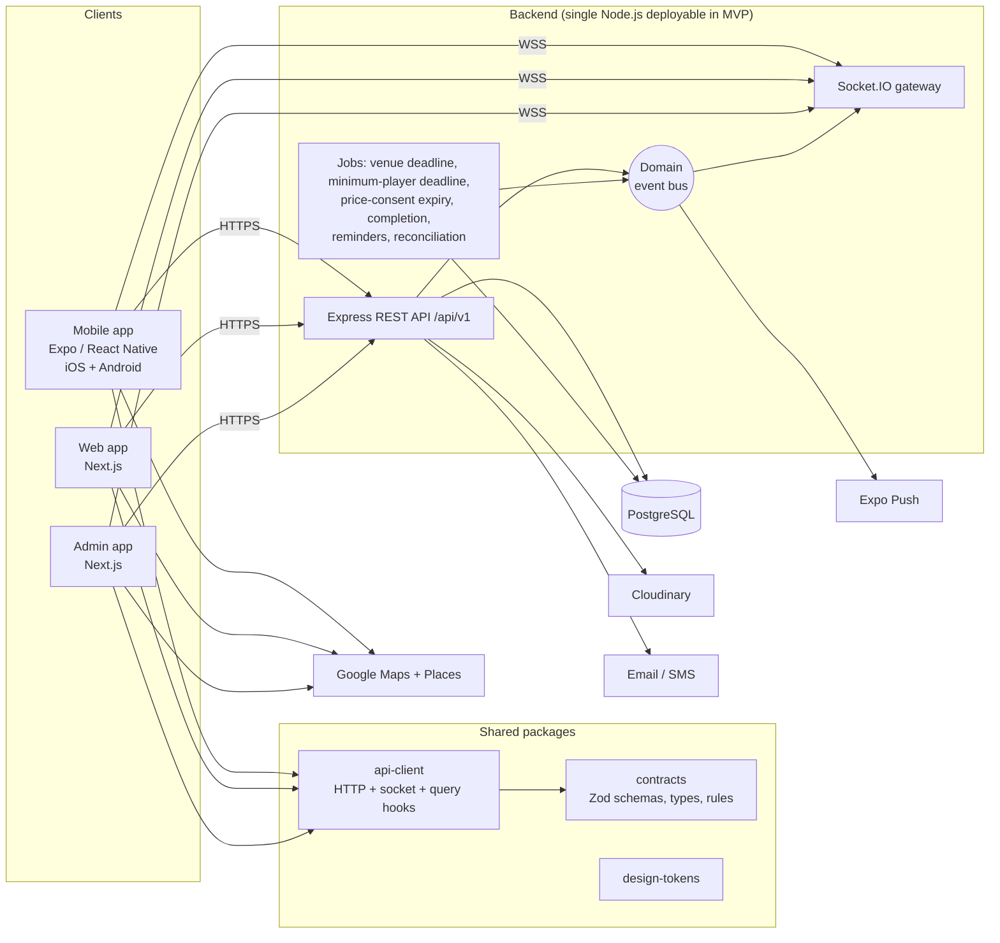

# Architecture and Technology Stack

MVP architecture for offline payments. **No payment provider is integrated.** Stripe, checkout, webhooks and payouts are future work: see [future/online-payments-stripe.md](../future/online-payments-stripe.md). Decision IDs refer to the [decision log](../decisions/decision-log.md).

## 1. Technology stack

| Layer | Choice | Status |
| --- | --- | --- |
| Monorepo | pnpm workspaces + Turborepo | DEC-004 |
| Mobile | React Native + Expo (dev builds, EAS) + TypeScript, Expo Router, NativeWind, Zustand, TanStack Query, React Hook Form + Zod, `react-native-maps` (Google) | DEC-004; libraries recommended |
| Web | Next.js (App Router) + TypeScript, Tailwind CSS, shadcn/ui, TanStack Query, React Hook Form + Zod, Google Maps JS | DEC-004; libraries recommended |
| Admin | Separate Next.js + TypeScript app, same UI stack as web | DEC-003, DEC-004 |
| API | Node.js + Express + TypeScript, Zod, Socket.IO, Swagger/OpenAPI | DEC-004 |
| Database | PostgreSQL 16 + Prisma | DEC-004, DEC-042 |
| Shared code | One `contracts` package: Zod schemas, inferred types, enums, error codes, pure rules | DEC-005 |
| Images | Cloudinary (signed direct uploads) | DEC-006 |
| Maps and places | Google Maps + Places (mobile, web, admin) | Recommended |
| Push | Expo Push Notifications | ARC-007 |
| Email | Transactional email provider (to choose in Phase 3); Mailpit locally | Recommended |
| SMS (phone OTP) | Provider to choose | O-13 |
| Local development | Docker Compose: PostgreSQL 16 + Mailpit | DEC-007 |
| Node.js runtime | **Node.js 26.13.0** Active LTS, pinned in `.nvmrc` and `engines`. TypeScript 6.0.3 (eslint 8.72 does not yet support TypeScript 6.1). Web/admin use Tailwind CSS v4; mobile NativeWind 4 still uses Tailwind 3. | DEC-008 |
| Hosting | AWS Middle East (UAE, `me-central-1`), subject to cost and data-residency review | DEC-041 (Recommended), L-08 |

## 2. Overview



The MVP ships **one backend deployable**. The REST API, Socket.IO gateway and jobs run in one Node process, each as a separate module (ARC-001). To scale beyond one instance:
- add **Redis** for the Socket.IO adapter, the rate-limit store and BullMQ queues;
- move jobs to a `worker` process (same codebase, different entrypoint).

Jobs already use `FOR UPDATE SKIP LOCKED`, so running several instances is safe from day one.

There is no money flow through the system. The API stores **payment records** that players and organisers update (DEC-012, DEC-023).

## 3. Architectural decisions

| # | Decision | Why |
| --- | --- | --- |
| AD-1 | **Modular monolith** (ARC-001) | One team, one database, transactional capacity and payment-record rules. Module boundaries allow splitting out later. |
| AD-2 | **`contracts` package** is the single source of truth for request/response schemas, enums and error codes (DEC-005) | The API validates with it; all three frontends build forms and types from it; OpenAPI is generated from it (ARC-008). |
| AD-3 | **Shared `api-client`** with TanStack Query hooks | Mobile, web and admin are all React. Token storage and base URL are injected per platform. |
| AD-4 | **No shared UI components** between React Native and DOM (ARC-009) | Only design tokens are shared. Web and admin may share DOM components later. |
| AD-5 | **Business rules authoritative in API services**; pure helpers in `contracts/rules` (`splitShares`, `spotsLeft`, `isJoinable`, `priceChangeImpact`, `validateSessionDraft`) for client previews | The server always recomputes. |
| AD-6 | **Integer fils for money**, plus currency on each row (DEC-019) | No floating-point errors; largest-remainder splits always sum to the total. |
| AD-7 | **Row locks for capacity** (`SELECT … FOR UPDATE` on the session), DB CHECK constraints and unique keys, including unique `(session_id, share_slot)` (ARC-004) | Overbooking and double-assigned shares are impossible under concurrency. |
| AD-8 | **Separate state fields**: session status, venue confirmation, minimum-player decision, participant status and payment status (DEC-015) | Each has one owner and one state machine. |
| AD-9 | **Payment records behind a module boundary** | `offline-payments` reacts to participant and price events. A future provider module can sit beside it without changes to session code ([future](../future/online-payments-stripe.md)). |
| AD-10 | **Persist first, then emit** (ARC-006) | State and notifications are committed before socket and push delivery, so offline users get everything later. |
| AD-11 | **Access JWT (15 min) + rotating refresh token (30 days) with reuse detection** (ARC-003); staff TOTP (DEC-037) | Revocable sessions; strong staff authentication. |
| AD-12 | **`/api/v1` versioning** plus a minimum-app-version header | Mobile clients can't be force-updated instantly. |
| AD-13 | **Append-only audit trails**: `session_events`, `payment_confirmations`, `admin_audit_logs` | Disputes and support need to know who changed what. |

## 4. Backend modules (`apps/api/src/modules`)

| Module | Responsibility | Emits events |
| --- | --- | --- |
| `auth` | Register, login, Google/Apple sign-in, refresh rotation, logout, email and phone verification, password reset, staff TOTP | — |
| `users` | Profile, favourite sports, devices, account deletion | `user.deleted` |
| `sports` | Catalogue, including sport-level player limits (cached) | — |
| `venues` | Catalogue, search, nearby, Place ID dedupe, staff-only contact fields, merge | — |
| `venue-arrangements` | LFP coordination queue, venue options, organiser approval, venue bookings for both types | `venue_arrangement.*`, `venue.confirmed` |
| `sessions` | Create both types, edit (including price/capacity changes and consents), cancel, minimum-player decision, state machine, my activities | `session.created/updated/cancelled/completed/expired` |
| `participants` | Interest, join, leave, remove, share slots, attendance, counters | `participant.*`, `session.availability_changed` |
| `offline-payments` | Payment records, report/confirm/waive/refund, disputes, reminders | `payment.*`, `payment_dispute.*` |
| `discovery` | Nearby search, radius expansion, distance bands | — |
| `notifications` | Persist, list, read state, push delivery, preferences | `notification.created` |
| `reviews` | Post-session reviews | — |
| `reports` | User, session and review reports | — |
| `uploads` | Signed Cloudinary uploads | — |
| `admin` | Admin routers, platform settings, audit log | — |
| `realtime` | Socket.IO gateway; subscribes to the event bus | — |

**Layering:** `routes → controller → service → repository (Prisma)`. Services own transactions; controllers contain no logic.

**Dependency rule:** modules call each other only through their exported `*.service.ts`, never through repositories.
- `participants` calls `offlinePayments.onParticipationChanged()` inside the join and leave transaction to create, reactivate or deactivate the payment record.
- `sessions` calls `participants.repackShares()` and `offlinePayments.applyAmountChanges()` inside a price or capacity edit.
- `venue-arrangements` calls `sessions.confirmVenue()`.

**Cross-cutting concerns:**
- Zod `validate` middleware.
- A typed `AppError` plus error middleware.
- `pino` logging with request IDs; coordinates, phone numbers and payment references are redacted.
- `helmet`, a CORS allow-list and `express-rate-limit`.
- `Idempotency-Key` middleware on session creation, join, leave and every payment and venue action.
- OpenAPI via `@asteasolutions/zod-to-openapi` at `/docs`.
- Environment variables validated at boot.

## 5. Real-time and notifications

### Socket.IO rooms

| Room | Who | Events |
| --- | --- | --- |
| `session:{id}` | Anyone viewing the session or its card (public data only) | `session:availability`, `session:status`, `session:updated`, `session:venue_confirmed`, `session:participant_joined/left` |
| `user:{id}` | The user's authenticated sockets | `notification:new`, `notification:unread_count`, `participant:updated`, `payment:updated`, `price_consent:required`, `venue_arrangement:updated` |
| `admin` | Staff sockets | `admin:feed` (new venue arrangement requests, open payment disputes, reports) |

Payloads are defined in [API specification §4](../api/api-specification.md#4-socketio-contract).

- The handshake authenticates with the access token. Unauthenticated sockets can only subscribe to `session:*`.
- Discovery screens subscribe to the session IDs currently visible (max 50 per socket).
- Clients patch the TanStack Query cache from events and ignore any event with `version ≤ cached.version`.
- On reconnect, clients refetch active queries. Missed events aren't replayed; persisted notifications cover offline users.

### Notification pipeline

```
domain event ──► notifications.service (same DB transaction as the change)
                    ├─ INSERT notifications (one per recipient)
                    └─ after commit:
                         ├─ socket emit to user:{id}
                         └─ push via Expo (respecting notification preferences), mark pushed_at
```

The notification catalogue is in [session lifecycle §8](../workflows/session-lifecycle.md#8-notifications).

### Designed for future chat (DEC-010, not built)
- The gateway is organised around channels (`session:{id}`, `user:{id}`). A future `conversation:{id}` channel plugs in the same way, and session chat can reuse `session:{id}` membership rules (confirmed participants only).
- Notifications use a generic `entity_type` / `entity_id` pair, so a later `MESSAGE` type needs no schema change.
- Push delivery, preferences and unread counts are channel-agnostic. Chat will need Redis for the socket adapter.

## 6. Client applications

### Mobile (`apps/mobile`)
- Expo **development builds** and EAS. Expo Router groups: `(auth)`, `(tabs)/discover|activities|create|notifications|profile`, `session/[id]`, `session/[id]/payments` (organiser), `session/[id]/venue-options` (organiser, LFP), `payment/[id]`.
- NativeWind with the design tokens. `expo-blur` on iOS; translucent solid fallback on Android.
- `react-native-reanimated`, `@shopify/flash-list`, `react-native-maps` (Google provider), `expo-location`, `expo-secure-store`, `expo-notifications`, `expo-auth-session` / `expo-apple-authentication`.
- Deep links: `playaround://`, plus universal links on the launch domain once verified (DEC-040, L-07).

### Web (`apps/web`)
- Next.js App Router. SSR for the landing page and the public share page `/s/[id]` (Open Graph); the authenticated app is client-heavy.
- Desktop Discover: filters, list and a sticky map, with hover-linking between cards and markers. Tablet: list with a map toggle. Mobile web: bottom-sheet list over the map.
- `@vis.gl/react-google-maps` and Places Autocomplete.

### Admin (`apps/admin`)
See [admin-application.md](admin-application.md).

## 7. Design system

`packages/design-tokens` exports colours, radii, spacing, typography, blur and motion as TypeScript objects. They feed a Tailwind preset (web, admin) and the NativeWind config (mobile).

- Glass is for chrome and floating surfaces: headers, tab bar, chips, map overlays and sheets. Dense content sits on near-opaque surfaces. Text on glass meets AA contrast in light and dark themes.
- Per-sport accents (badminton teal, football green, cricket amber) are stored on `sports.accent_color`, so new sports get colours without a release.
- Component inventory (per platform, same names and props): `GlassCard`, `GlassButton`, `GlassInput`, `SportCard`, `SessionCard`, `PlayerAvatar`/`AvatarStack`, `LocationSelector`, `SportFilter`, `BottomNavigation`/`SideNav`, `AppHeader`, `EmptyState`, `LoadingSkeleton`, `DistanceBadge`, `SpotsIndicator`, `PriceBreakdown`, `PaymentStatusBadge`, `PayOrganiserNotice`, `VenueStatusBadge`, `PriceConsentSheet`, `MinPlayersBanner`.

## 8. Monorepo structure (target for Phase 2)

```
playaround/
├── apps/
│   ├── api/
│   │   ├── prisma/
│   │   │   ├── schema.prisma
│   │   │   ├── migrations/
│   │   │   └── seed/
│   │   ├── src/
│   │   │   ├── app.ts                 # express app factory
│   │   │   ├── server.ts              # http + socket.io + jobs bootstrap
│   │   │   ├── worker.ts              # (later) jobs only
│   │   │   ├── config/
│   │   │   ├── lib/                   # prisma, logger, errors, event-bus, geo, money, idempotency
│   │   │   ├── middleware/
│   │   │   ├── modules/
│   │   │   │   ├── auth/  users/  sports/  venues/  venue-arrangements/
│   │   │   │   ├── sessions/  participants/  offline-payments/  discovery/
│   │   │   │   ├── notifications/  reviews/  reports/  uploads/  admin/
│   │   │   ├── realtime/
│   │   │   ├── jobs/
│   │   │   └── docs/
│   │   └── test/                      # integration and concurrency tests
│   ├── mobile/
│   │   ├── app/                       # expo-router
│   │   └── src/{components,features,lib,stores,theme}/
│   ├── web/
│   │   └── src/{app,components,features,lib,stores}/
│   └── admin/
│       └── src/{app,components,features,lib}/
├── packages/
│   ├── contracts/                     # zod schemas, enums, error codes, rules/ (split, joinability, price change, validation)
│   ├── api-client/                    # fetch client, refresh, query keys, hooks, socket client
│   ├── design-tokens/
│   └── config/                        # tsconfig, eslint, prettier presets
├── infrastructure/
│   ├── docker/docker-compose.yml      # postgres 16, mailpit
│   └── database/init/
├── docs/
│   ├── README.md  roadmap.md
│   ├── product/  architecture/  database/  api/  workflows/
│   └── future/  decisions/  archive/
├── .env.example
├── .nvmrc                             # 26.13.0 (DEC-008)
├── .github/workflows/ci.yml
├── package.json
├── pnpm-workspace.yaml
└── turbo.json
```

## 9. Environments and configuration

| Env | API | Database | Notes |
| --- | --- | --- | --- |
| local | `pnpm dev` | PostgreSQL 16 via Colima + Docker Compose (`pnpm db:up`) | Mailpit at http://localhost:8025; SMS codes logged to the console. If Compose is down, the API still boots and `/health/ready` reports `database: down`. |
| staging | Hosted (L-08) | Anonymised seed | Real email/SMS to allow-listed recipients only |
| production | Hosted (L-08) | Managed PostgreSQL with point-in-time recovery | — |

Secrets (JWT keys, TOTP encryption key, Google/Apple sign-in credentials, Maps keys, Cloudinary, email/SMS keys) live only in environment variables or the host's secret manager. The API's Zod config schema validates them at boot. No payment-provider keys exist in the MVP.

## 10. Development standards

- TypeScript `strict`; ESLint and Prettier from `packages/config`; Husky and lint-staged; Conventional Commits.
- Database uses `snake_case` via `@@map`; API JSON uses `camelCase`. Money is always `{ amountFils, currency }`.
- Tests: Vitest and Supertest against a real PostgreSQL test database (transactions can't be mocked meaningfully). Playwright for web and admin E2E, Maestro for mobile.
- Required concurrency tests: joins at capacity, concurrent leave and join, and concurrent payment actions.
- Definition of done for any screen: loading skeleton, empty state, error and retry, both themes, accessibility labels.
- Docs are updated in the same change as the behaviour they describe.
