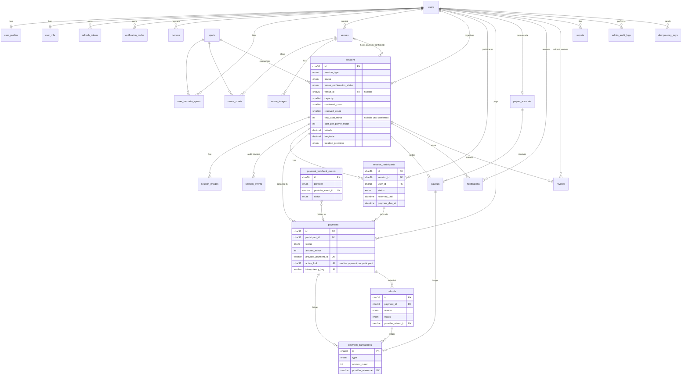

> ⚠️ **SUPERSEDED — historical reference only.** Archived 8 Nov 2026.
> Kept because its Stripe-oriented tables (`payments`, `payment_transactions`, `payment_webhook_events`, `refunds`, `payout_accounts`, `payouts`) are the starting point for the [future online payments design](../future/online-payments-stripe.md). **Do not implement from this file.**
> Current schema: [database/schema.md](../database/schema.md).

# Database Design (v2)

MySQL 8.4, InnoDB, `utf8mb4_0900_ai_ci`, managed by Prisma migrations.
- Timestamps are UTC `DATETIME(3)`.
- Money is integer minor units (`*_minor`) with a `currency CHAR(3)`.
- IDs are UUID v7 `CHAR(36)` (time-ordered, non-guessable).
- The draft below passes `prisma validate` on Prisma 6.

## 1. Entity relationship diagram



## 2. Prisma schema (draft)

This moves to `apps/api/prisma/schema.prisma` in Phase 2.

```prisma
generator client {
  provider = "prisma-client-js"
}

datasource db {
  provider = "mysql"
  url      = env("DATABASE_URL")
}

// ═════════════ Enums ═════════════

enum UserRole {
  USER
  SUPPORT
  OPERATIONS
  FINANCE
  SUPER_ADMIN
}

enum UserStatus {
  ACTIVE
  SUSPENDED
  DELETED
}

enum SkillLevel {
  BEGINNER
  INTERMEDIATE
  ADVANCED
  PROFESSIONAL
}

enum VerificationPurpose {
  EMAIL_VERIFY
  PASSWORD_RESET
  PHONE_VERIFY
}

enum DevicePlatform {
  IOS
  ANDROID
  WEB
}

enum SessionType {
  EXISTING_BOOKING
  LOOKING_FOR_PLAYERS
}

enum SessionStatus {
  OPEN
  FULL
  CANCELLED
  COMPLETED
  EXPIRED
}

enum VenueConfirmationStatus {
  PENDING
  CONFIRMED
  LAPSED
}

enum LocationPrecision {
  EXACT
  AREA
}

enum SessionVisibility {
  PUBLIC
  UNLISTED
}

enum CancellationReason {
  ORGANISER_CANCELLED
  VENUE_NOT_CONFIRMED
  ADMIN_CANCELLED
  ORGANISER_ACCOUNT_DELETED
}

enum ParticipantRole {
  ORGANISER
  PLAYER
}

enum ParticipantStatus {
  INTERESTED
  HELD
  PENDING_PAYMENT
  CONFIRMED
  LEFT
  REMOVED
  EXPIRED
  CANCELLED
}

enum PaymentProvider {
  STRIPE
  TAP
  FAKE
}

enum PaymentStatus {
  CREATED
  PENDING
  SUCCEEDED
  FAILED
  EXPIRED
  CANCELLED
  PARTIALLY_REFUNDED
  REFUNDED
  DISPUTED
}

enum PaymentTransactionType {
  CHARGE
  REFUND
  TRANSFER
  TRANSFER_REVERSAL
  DISPUTE
  DISPUTE_REVERSAL
  PROVIDER_FEE
}

enum PaymentTransactionStatus {
  PENDING
  SUCCEEDED
  FAILED
}

enum WebhookEventStatus {
  RECEIVED
  PROCESSING
  PROCESSED
  IGNORED
  FAILED
}

enum RefundStatus {
  REQUESTED
  PENDING
  SUCCEEDED
  FAILED
}

enum RefundReason {
  PLAYER_LEFT
  SESSION_CANCELLED
  SESSION_CHANGED
  REMOVED_BY_ORGANISER
  RESERVATION_EXPIRED
  AMOUNT_MISMATCH
  DUPLICATE
  REPORT_UPHELD
  ADMIN_ADJUSTMENT
}

enum PayoutAccountOwnerType {
  USER
  VENUE
}

enum PayoutAccountStatus {
  ONBOARDING
  RESTRICTED
  ACTIVE
  DISABLED
}

enum PayoutStatus {
  SCHEDULED
  ON_HOLD
  PROCESSING
  PAID
  FAILED
  CANCELLED
}

enum NotificationType {
  PLAYER_INTERESTED
  PLAYER_JOINED
  PLAYER_LEFT
  PLAYER_REMOVED
  SESSION_FULL
  SESSION_REOPENED
  SESSION_UPDATED
  SESSION_CANCELLED
  SESSION_REMINDER
  VENUE_CONFIRMED
  VENUE_CONFIRMATION_DUE
  PAYMENT_DUE
  RESERVATION_EXPIRING
  RESERVATION_EXPIRED
  PAYMENT_SUCCEEDED
  PAYMENT_FAILED
  REFUND_ISSUED
  PAYOUT_SENT
  PAYOUT_ACCOUNT_ACTION_REQUIRED
  REVIEW_RECEIVED
}

enum ReportTargetType {
  USER
  SESSION
  REVIEW
}

enum ReportStatus {
  OPEN
  ACTIONED
  DISMISSED
}

// ═════════════ Identity ═════════════

model User {
  id              String     @id @default(uuid(7)) @db.Char(36)
  email           String     @unique @db.VarChar(191)
  phone           String?    @unique @db.VarChar(20)
  passwordHash    String     @map("password_hash") @db.VarChar(255)
  role            UserRole   @default(USER)
  status          UserStatus @default(ACTIVE)
  emailVerifiedAt DateTime?  @map("email_verified_at") @db.DateTime(3)
  lastLoginAt     DateTime?  @map("last_login_at") @db.DateTime(3)
  createdAt       DateTime   @default(now()) @map("created_at") @db.DateTime(3)
  updatedAt       DateTime   @updatedAt @map("updated_at") @db.DateTime(3)
  deletedAt       DateTime?  @map("deleted_at") @db.DateTime(3)

  profile            UserProfile?
  mfa                UserMfa?
  refreshTokens      RefreshToken[]
  verificationCodes  VerificationCode[]
  devices            Device[]
  favouriteSports    UserFavouriteSport[]
  venuesCreated      Venue[]
  organisedSessions  Session[]             @relation("SessionOrganiser")
  participations     SessionParticipant[]
  payments           Payment[]
  payoutAccount      PayoutAccount?
  notifications      Notification[]        @relation("NotificationRecipient")
  notificationsActed Notification[]        @relation("NotificationActor")
  reviewsWritten     Review[]              @relation("Reviewer")
  reviewsReceived    Review[]              @relation("Reviewee")
  reportsFiled       Report[]              @relation("Reporter")
  reportsResolved    Report[]              @relation("ReportResolver")
  sessionEvents      SessionEvent[]
  refundsInitiated   Refund[]
  adminActions       AdminAuditLog[]
  idempotencyKeys    IdempotencyKey[]
  settingsUpdated    PlatformSetting[]

  @@index([role])
  @@map("users")
}

model UserProfile {
  userId            String    @id @map("user_id") @db.Char(36)
  displayName       String    @map("display_name") @db.VarChar(60)
  avatarUrl         String?   @map("avatar_url") @db.VarChar(500)
  bio               String?   @db.VarChar(280)
  homeAreaLabel     String?   @map("home_area_label") @db.VarChar(120)
  homeLatitude      Decimal?  @map("home_latitude") @db.Decimal(5, 2)   // coarse ~1 km, private
  homeLongitude     Decimal?  @map("home_longitude") @db.Decimal(5, 2)
  defaultRadiusKm   Int       @default(5) @map("default_radius_km") @db.SmallInt
  notificationPrefs Json?     @map("notification_prefs")
  ratingAvg         Decimal   @default(0) @map("rating_avg") @db.Decimal(3, 2)
  ratingCount       Int       @default(0) @map("rating_count")
  sessionsPlayed    Int       @default(0) @map("sessions_played")
  updatedAt         DateTime  @updatedAt @map("updated_at") @db.DateTime(3)

  user User @relation(fields: [userId], references: [id], onDelete: Cascade)

  @@map("user_profiles")
}

model UserMfa {
  userId          String    @id @map("user_id") @db.Char(36)
  totpSecretEnc   String    @map("totp_secret_enc") @db.VarChar(255)   // encrypted at rest
  enabledAt       DateTime? @map("enabled_at") @db.DateTime(3)
  recoveryCodes   Json      @map("recovery_codes")                     // hashed

  user User @relation(fields: [userId], references: [id], onDelete: Cascade)

  @@map("user_mfa")
}

model RefreshToken {
  id           String    @id @default(uuid(7)) @db.Char(36)
  userId       String    @map("user_id") @db.Char(36)
  tokenHash    String    @unique @map("token_hash") @db.Char(64)
  familyId     String    @map("family_id") @db.Char(36)
  replacedById String?   @map("replaced_by_id") @db.Char(36)
  audience     String    @default("app") @db.VarChar(10)               // app | admin
  userAgent    String?   @map("user_agent") @db.VarChar(255)
  expiresAt    DateTime  @map("expires_at") @db.DateTime(3)
  revokedAt    DateTime? @map("revoked_at") @db.DateTime(3)
  createdAt    DateTime  @default(now()) @map("created_at") @db.DateTime(3)

  user User @relation(fields: [userId], references: [id], onDelete: Cascade)

  @@index([userId])
  @@index([familyId])
  @@map("refresh_tokens")
}

model VerificationCode {
  id         String              @id @default(uuid(7)) @db.Char(36)
  userId     String              @map("user_id") @db.Char(36)
  purpose    VerificationPurpose
  codeHash   String              @map("code_hash") @db.Char(64)
  attempts   Int                 @default(0) @db.TinyInt
  expiresAt  DateTime            @map("expires_at") @db.DateTime(3)
  consumedAt DateTime?           @map("consumed_at") @db.DateTime(3)
  createdAt  DateTime            @default(now()) @map("created_at") @db.DateTime(3)

  user User @relation(fields: [userId], references: [id], onDelete: Cascade)

  @@index([userId, purpose])
  @@map("verification_codes")
}

model Device {
  id         String         @id @default(uuid(7)) @db.Char(36)
  userId     String         @map("user_id") @db.Char(36)
  platform   DevicePlatform
  pushToken  String         @unique @map("push_token") @db.VarChar(255)
  lastSeenAt DateTime       @default(now()) @map("last_seen_at") @db.DateTime(3)

  user User @relation(fields: [userId], references: [id], onDelete: Cascade)

  @@index([userId])
  @@map("devices")
}

// ═════════════ Catalogue ═════════════

model Sport {
  id             Int     @id @default(autoincrement())
  slug           String  @unique @db.VarChar(40)
  name           String  @db.VarChar(60)
  iconKey        String  @map("icon_key") @db.VarChar(40)
  accentColor    String  @map("accent_color") @db.Char(7)
  minPlayers     Int     @map("min_players") @db.SmallInt
  maxPlayers     Int     @map("max_players") @db.SmallInt
  defaultPlayers Int     @map("default_players") @db.SmallInt
  isActive       Boolean @default(true) @map("is_active")
  sortOrder      Int     @default(0) @map("sort_order") @db.SmallInt

  sessions     Session[]
  venueSports  VenueSport[]
  favouritedBy UserFavouriteSport[]

  @@map("sports")
}

model UserFavouriteSport {
  userId     String     @map("user_id") @db.Char(36)
  sportId    Int        @map("sport_id")
  skillLevel SkillLevel @default(INTERMEDIATE) @map("skill_level")

  user  User  @relation(fields: [userId], references: [id], onDelete: Cascade)
  sport Sport @relation(fields: [sportId], references: [id])

  @@id([userId, sportId])
  @@index([sportId])
  @@map("user_favourite_sports")
}

model Venue {
  id            String   @id @default(uuid(7)) @db.Char(36)
  googlePlaceId String?  @unique @map("google_place_id") @db.VarChar(255)
  name          String   @db.VarChar(120)
  addressLine   String   @map("address_line") @db.VarChar(255)
  area          String?  @db.VarChar(120)
  city          String   @db.VarChar(80)
  countryCode   String   @map("country_code") @db.Char(2)
  latitude      Decimal  @db.Decimal(9, 6)
  longitude     Decimal  @db.Decimal(9, 6)
  timezone      String   @db.VarChar(64)
  isVerified    Boolean  @default(false) @map("is_verified")
  mergedIntoId  String?  @map("merged_into_id") @db.Char(36)          // admin duplicate merge
  createdById   String?  @map("created_by_id") @db.Char(36)
  createdAt     DateTime @default(now()) @map("created_at") @db.DateTime(3)
  updatedAt     DateTime @updatedAt @map("updated_at") @db.DateTime(3)

  createdBy User?        @relation(fields: [createdById], references: [id], onDelete: SetNull)
  sports    VenueSport[]
  images    VenueImage[]
  sessions  Session[]

  @@index([latitude, longitude])
  @@index([city])
  @@map("venues")
}

model VenueSport {
  venueId String @map("venue_id") @db.Char(36)
  sportId Int    @map("sport_id")

  venue Venue @relation(fields: [venueId], references: [id], onDelete: Cascade)
  sport Sport @relation(fields: [sportId], references: [id])

  @@id([venueId, sportId])
  @@index([sportId])
  @@map("venue_sports")
}

model VenueImage {
  id         String   @id @default(uuid(7)) @db.Char(36)
  venueId    String   @map("venue_id") @db.Char(36)
  url        String   @db.VarChar(500)
  storageKey String   @map("storage_key") @db.VarChar(255)
  sortOrder  Int      @default(0) @map("sort_order") @db.SmallInt
  createdAt  DateTime @default(now()) @map("created_at") @db.DateTime(3)

  venue Venue @relation(fields: [venueId], references: [id], onDelete: Cascade)

  @@index([venueId])
  @@map("venue_images")
}

// ═════════════ Sessions ═════════════

model Session {
  id                          String                  @id @default(uuid(7)) @db.Char(36)
  organiserId                 String                  @map("organiser_id") @db.Char(36)
  sportId                     Int                     @map("sport_id")
  sessionType                 SessionType             @map("session_type")
  status                      SessionStatus           @default(OPEN)
  venueConfirmationStatus     VenueConfirmationStatus @map("venue_confirmation_status")
  visibility                  SessionVisibility       @default(PUBLIC)

  // where
  venueId                     String?                 @map("venue_id") @db.Char(36)   // required when CONFIRMED
  preferredAreaLabel          String?                 @map("preferred_area_label") @db.VarChar(120)
  areaRadiusKm                Decimal?                @map("area_radius_km") @db.Decimal(4, 1)
  latitude                    Decimal                 @db.Decimal(9, 6)              // venue or area centroid
  longitude                   Decimal                 @db.Decimal(9, 6)
  locationPrecision           LocationPrecision       @map("location_precision")
  timezone                    String                  @db.VarChar(64)

  // when
  startsAt                    DateTime                @map("starts_at") @db.DateTime(3)  // proposed while PENDING
  endsAt                      DateTime                @map("ends_at") @db.DateTime(3)
  venueConfirmDeadline        DateTime?               @map("venue_confirm_deadline") @db.DateTime(3)
  venueConfirmedAt            DateTime?               @map("venue_confirmed_at") @db.DateTime(3)

  // who
  capacity                    Int                     @db.SmallInt     // incl. organiser if playing
  organiserIsPlaying          Boolean                 @default(true) @map("organiser_is_playing")
  confirmedCount              Int                     @default(0) @map("confirmed_count") @db.SmallInt
  reservedCount               Int                     @default(0) @map("reserved_count") @db.SmallInt
  interestedCount             Int                     @default(0) @map("interested_count") @db.SmallInt
  skillLevel                  SkillLevel?             @map("skill_level")

  // money (minor units)
  currency                    String                  @default("AED") @db.Char(3)
  estimatedTotalCostMinor     Int?                    @map("estimated_total_cost_minor")
  estimatedCostPerPlayerMinor Int?                    @map("estimated_cost_per_player_minor")
  totalCostMinor              Int?                    @map("total_cost_minor")          // set when venue CONFIRMED
  costPerPlayerMinor          Int?                    @map("cost_per_player_minor")
  serviceFeeMinor             Int?                    @map("service_fee_minor")         // per player, snapshot
  priceLockedAt               DateTime?               @map("price_locked_at") @db.DateTime(3)
  bookingReference            String?                 @map("booking_reference") @db.VarChar(80)

  // content
  title                       String?                 @db.VarChar(100)
  instructions                String?                 @db.Text

  // lifecycle
  cancelledAt                 DateTime?               @map("cancelled_at") @db.DateTime(3)
  cancellationReason          CancellationReason?     @map("cancellation_reason")
  cancellationNote            String?                 @map("cancellation_note") @db.VarChar(280)
  closedAt                    DateTime?               @map("closed_at") @db.DateTime(3)
  version                     Int                     @default(0)
  createdAt                   DateTime                @default(now()) @map("created_at") @db.DateTime(3)
  updatedAt                   DateTime                @updatedAt @map("updated_at") @db.DateTime(3)

  organiser     User                 @relation("SessionOrganiser", fields: [organiserId], references: [id])
  sport         Sport                @relation(fields: [sportId], references: [id])
  venue         Venue?               @relation(fields: [venueId], references: [id])
  participants  SessionParticipant[]
  images        SessionImage[]
  events        SessionEvent[]
  payments      Payment[]
  payout        Payout?
  notifications Notification[]
  reviews       Review[]

  @@index([status, startsAt])
  @@index([latitude, longitude])
  @@index([sportId, status, startsAt])
  @@index([organiserId, startsAt])
  @@index([venueId, startsAt])
  @@index([venueConfirmationStatus, venueConfirmDeadline])   // lapse scheduler
  @@index([status, endsAt])                                  // completion scheduler
  @@map("sessions")
}

model SessionParticipant {
  id            String            @id @default(uuid(7)) @db.Char(36)
  sessionId     String            @map("session_id") @db.Char(36)
  userId        String            @map("user_id") @db.Char(36)
  role          ParticipantRole   @default(PLAYER)
  status        ParticipantStatus
  reservedUntil DateTime?         @map("reserved_until") @db.DateTime(3)   // PENDING_PAYMENT
  paymentDueAt  DateTime?         @map("payment_due_at") @db.DateTime(3)   // HELD after venue confirmed
  confirmedAt   DateTime?         @map("confirmed_at") @db.DateTime(3)
  leftAt        DateTime?         @map("left_at") @db.DateTime(3)
  createdAt     DateTime          @default(now()) @map("created_at") @db.DateTime(3)
  updatedAt     DateTime          @updatedAt @map("updated_at") @db.DateTime(3)

  session  Session   @relation(fields: [sessionId], references: [id], onDelete: Cascade)
  user     User      @relation(fields: [userId], references: [id])
  payments Payment[]

  @@unique([sessionId, userId])
  @@index([userId, status])
  @@index([sessionId, status])
  @@index([status, reservedUntil])   // reservation sweeper
  @@index([status, paymentDueAt])    // payment-due sweeper
  @@map("session_participants")
}

model SessionImage {
  id         String   @id @default(uuid(7)) @db.Char(36)
  sessionId  String   @map("session_id") @db.Char(36)
  url        String   @db.VarChar(500)
  storageKey String   @map("storage_key") @db.VarChar(255)
  sortOrder  Int      @default(0) @map("sort_order") @db.SmallInt
  createdAt  DateTime @default(now()) @map("created_at") @db.DateTime(3)

  session Session @relation(fields: [sessionId], references: [id], onDelete: Cascade)

  @@index([sessionId])
  @@map("session_images")
}

/// Append-only timeline used by the admin dashboard and for debugging.
model SessionEvent {
  id        String   @id @default(uuid(7)) @db.Char(36)
  sessionId String   @map("session_id") @db.Char(36)
  actorId   String?  @map("actor_id") @db.Char(36)                    // null = system/job
  type      String   @db.VarChar(60)                                  // e.g. "status.changed", "venue.confirmed"
  data      Json?
  createdAt DateTime @default(now()) @map("created_at") @db.DateTime(3)

  session Session @relation(fields: [sessionId], references: [id], onDelete: Cascade)
  actor   User?   @relation(fields: [actorId], references: [id], onDelete: SetNull)

  @@index([sessionId, createdAt])
  @@map("session_events")
}

// ═════════════ Payments ═════════════

model Payment {
  id                 String          @id @default(uuid(7)) @db.Char(36)
  participantId      String          @map("participant_id") @db.Char(36)
  sessionId          String          @map("session_id") @db.Char(36)
  userId             String          @map("user_id") @db.Char(36)
  provider           PaymentProvider
  status             PaymentStatus   @default(CREATED)
  shareMinor         Int             @map("share_minor")
  serviceFeeMinor    Int             @map("service_fee_minor")
  amountMinor        Int             @map("amount_minor")              // share + fee
  refundedMinor      Int             @default(0) @map("refunded_minor")
  currency           String          @db.Char(3)
  idempotencyKey     String          @unique @map("idempotency_key") @db.VarChar(64)
  activeLock         String?         @unique @map("active_lock") @db.Char(36)   // = participant_id while live
  providerCheckoutId String?         @unique @map("provider_checkout_id") @db.VarChar(255)
  providerPaymentId  String?         @unique @map("provider_payment_id") @db.VarChar(255)
  checkoutUrl        String?         @map("checkout_url") @db.VarChar(1000)
  expiresAt          DateTime        @map("expires_at") @db.DateTime(3)
  succeededAt        DateTime?       @map("succeeded_at") @db.DateTime(3)
  failedAt           DateTime?       @map("failed_at") @db.DateTime(3)
  failureCode        String?         @map("failure_code") @db.VarChar(64)
  failureMessage     String?         @map("failure_message") @db.VarChar(255)
  metadata           Json?
  createdAt          DateTime        @default(now()) @map("created_at") @db.DateTime(3)
  updatedAt          DateTime        @updatedAt @map("updated_at") @db.DateTime(3)

  participant   SessionParticipant   @relation(fields: [participantId], references: [id])
  session       Session              @relation(fields: [sessionId], references: [id])
  user          User                 @relation(fields: [userId], references: [id])
  transactions  PaymentTransaction[]
  refunds       Refund[]
  webhookEvents PaymentWebhookEvent[]

  @@index([userId, createdAt])          // payment history
  @@index([sessionId, status])
  @@index([status, expiresAt])          // reconciliation
  @@map("payments")
}

/// Append-only ledger of every money movement seen at the provider.
model PaymentTransaction {
  id                String                   @id @default(uuid(7)) @db.Char(36)
  paymentId         String?                  @map("payment_id") @db.Char(36)
  refundId          String?                  @map("refund_id") @db.Char(36)
  payoutId          String?                  @map("payout_id") @db.Char(36)
  type              PaymentTransactionType
  status            PaymentTransactionStatus
  amountMinor       Int                      @map("amount_minor")      // signed from platform's view
  currency          String                   @db.Char(3)
  provider          PaymentProvider
  providerReference String?                  @map("provider_reference") @db.VarChar(255)
  occurredAt        DateTime                 @map("occurred_at") @db.DateTime(3)
  raw               Json?
  createdAt         DateTime                 @default(now()) @map("created_at") @db.DateTime(3)

  payment Payment? @relation(fields: [paymentId], references: [id])
  refund  Refund?  @relation(fields: [refundId], references: [id])
  payout  Payout?  @relation(fields: [payoutId], references: [id])

  @@unique([provider, type, providerReference])
  @@index([paymentId])
  @@index([payoutId])
  @@index([occurredAt])
  @@map("payment_transactions")
}

model PaymentWebhookEvent {
  id              String             @id @default(uuid(7)) @db.Char(36)
  provider        PaymentProvider
  providerEventId String             @map("provider_event_id") @db.VarChar(255)
  type            String             @db.VarChar(100)
  status          WebhookEventStatus @default(RECEIVED)
  paymentId       String?            @map("payment_id") @db.Char(36)
  payload         Json
  attempts        Int                @default(0) @db.SmallInt
  lastError       String?            @map("last_error") @db.VarChar(1000)
  receivedAt      DateTime           @default(now()) @map("received_at") @db.DateTime(3)
  processedAt     DateTime?          @map("processed_at") @db.DateTime(3)
  nextAttemptAt   DateTime?          @map("next_attempt_at") @db.DateTime(3)

  payment Payment? @relation(fields: [paymentId], references: [id])

  @@unique([provider, providerEventId])
  @@index([status, nextAttemptAt])
  @@index([paymentId])
  @@map("payment_webhook_events")
}

model Refund {
  id               String       @id @default(uuid(7)) @db.Char(36)
  paymentId        String       @map("payment_id") @db.Char(36)
  reason           RefundReason
  status           RefundStatus @default(REQUESTED)
  shareMinor       Int          @map("share_minor")
  serviceFeeMinor  Int          @map("service_fee_minor")
  amountMinor      Int          @map("amount_minor")
  currency         String       @db.Char(3)
  providerRefundId String?      @unique @map("provider_refund_id") @db.VarChar(255)
  initiatedById    String?      @map("initiated_by_id") @db.Char(36)    // null = system
  note             String?      @db.VarChar(280)
  attempts         Int          @default(0) @db.SmallInt
  failureMessage   String?      @map("failure_message") @db.VarChar(255)
  createdAt        DateTime     @default(now()) @map("created_at") @db.DateTime(3)
  completedAt      DateTime?    @map("completed_at") @db.DateTime(3)

  payment      Payment              @relation(fields: [paymentId], references: [id])
  initiatedBy  User?                @relation(fields: [initiatedById], references: [id], onDelete: SetNull)
  transactions PaymentTransaction[]

  @@index([paymentId])
  @@index([status, createdAt])
  @@map("refunds")
}

model PayoutAccount {
  id                String                 @id @default(uuid(7)) @db.Char(36)
  ownerType         PayoutAccountOwnerType @default(USER) @map("owner_type")
  userId            String?                @unique @map("user_id") @db.Char(36)
  provider          PaymentProvider
  providerAccountId String                 @unique @map("provider_account_id") @db.VarChar(255)
  status            PayoutAccountStatus    @default(ONBOARDING)
  country           String                 @db.Char(2)
  currency          String                 @db.Char(3)
  requirementsDue   Json?                  @map("requirements_due")
  createdAt         DateTime               @default(now()) @map("created_at") @db.DateTime(3)
  updatedAt         DateTime               @updatedAt @map("updated_at") @db.DateTime(3)

  user    User?    @relation(fields: [userId], references: [id])
  payouts Payout[]

  @@map("payout_accounts")
}

model Payout {
  id                 String       @id @default(uuid(7)) @db.Char(36)
  sessionId          String       @unique @map("session_id") @db.Char(36)   // one settlement per session
  payoutAccountId    String       @map("payout_account_id") @db.Char(36)
  status             PayoutStatus @default(SCHEDULED)
  grossMinor         Int          @map("gross_minor")       // Σ shares collected
  refundedMinor      Int          @map("refunded_minor")    // Σ share refunds
  amountMinor        Int          @map("amount_minor")      // transferred
  currency           String       @db.Char(3)
  scheduledFor       DateTime     @map("scheduled_for") @db.DateTime(3)
  holdReason         String?      @map("hold_reason") @db.VarChar(280)
  providerTransferId String?      @unique @map("provider_transfer_id") @db.VarChar(255)
  paidAt             DateTime?    @map("paid_at") @db.DateTime(3)
  createdAt          DateTime     @default(now()) @map("created_at") @db.DateTime(3)
  updatedAt          DateTime     @updatedAt @map("updated_at") @db.DateTime(3)

  session       Session              @relation(fields: [sessionId], references: [id])
  payoutAccount PayoutAccount        @relation(fields: [payoutAccountId], references: [id])
  transactions  PaymentTransaction[]

  @@index([status, scheduledFor])
  @@index([payoutAccountId, createdAt])
  @@map("payouts")
}

// ═════════════ Engagement ═════════════

model Notification {
  id         String           @id @default(uuid(7)) @db.Char(36)
  userId     String           @map("user_id") @db.Char(36)
  type       NotificationType
  title      String           @db.VarChar(120)
  body       String           @db.VarChar(500)
  entityType String?          @map("entity_type") @db.VarChar(30)   // session | payment | refund | payout | (future) conversation
  entityId   String?          @map("entity_id") @db.Char(36)
  sessionId  String?          @map("session_id") @db.Char(36)
  actorId    String?          @map("actor_id") @db.Char(36)
  data       Json?
  readAt     DateTime?        @map("read_at") @db.DateTime(3)
  pushedAt   DateTime?        @map("pushed_at") @db.DateTime(3)
  createdAt  DateTime         @default(now()) @map("created_at") @db.DateTime(3)

  user    User     @relation("NotificationRecipient", fields: [userId], references: [id], onDelete: Cascade)
  actor   User?    @relation("NotificationActor", fields: [actorId], references: [id], onDelete: SetNull)
  session Session? @relation(fields: [sessionId], references: [id], onDelete: SetNull)

  @@index([userId, createdAt])
  @@index([userId, readAt])
  @@map("notifications")
}

model Review {
  id         String   @id @default(uuid(7)) @db.Char(36)
  sessionId  String   @map("session_id") @db.Char(36)
  reviewerId String   @map("reviewer_id") @db.Char(36)
  revieweeId String   @map("reviewee_id") @db.Char(36)
  rating     Int      @db.TinyInt
  comment    String?  @db.VarChar(500)
  isHidden   Boolean  @default(false) @map("is_hidden")              // moderation
  createdAt  DateTime @default(now()) @map("created_at") @db.DateTime(3)

  session  Session @relation(fields: [sessionId], references: [id], onDelete: Cascade)
  reviewer User    @relation("Reviewer", fields: [reviewerId], references: [id])
  reviewee User    @relation("Reviewee", fields: [revieweeId], references: [id])

  @@unique([sessionId, reviewerId, revieweeId])
  @@index([revieweeId, createdAt])
  @@map("reviews")
}

model Report {
  id           String           @id @default(uuid(7)) @db.Char(36)
  reporterId   String           @map("reporter_id") @db.Char(36)
  targetType   ReportTargetType @map("target_type")
  targetId     String           @map("target_id") @db.Char(36)
  reason       String           @db.VarChar(60)
  details      String?          @db.VarChar(1000)
  status       ReportStatus     @default(OPEN)
  resolvedById String?          @map("resolved_by_id") @db.Char(36)
  resolution   String?          @db.VarChar(500)
  createdAt    DateTime         @default(now()) @map("created_at") @db.DateTime(3)
  resolvedAt   DateTime?        @map("resolved_at") @db.DateTime(3)

  reporter   User  @relation("Reporter", fields: [reporterId], references: [id])
  resolvedBy User? @relation("ReportResolver", fields: [resolvedById], references: [id])

  @@index([status, createdAt])
  @@index([targetType, targetId])
  @@map("reports")
}

// ═════════════ Platform ═════════════

model IdempotencyKey {
  id           String   @id @default(uuid(7)) @db.Char(36)
  userId       String   @map("user_id") @db.Char(36)
  key          String   @db.VarChar(64)
  method       String   @db.VarChar(8)
  path         String   @db.VarChar(255)
  requestHash  String   @map("request_hash") @db.Char(64)
  statusCode   Int?     @map("status_code") @db.SmallInt
  responseBody Json?    @map("response_body")
  lockedUntil  DateTime @map("locked_until") @db.DateTime(3)
  expiresAt    DateTime @map("expires_at") @db.DateTime(3)
  createdAt    DateTime @default(now()) @map("created_at") @db.DateTime(3)

  user User @relation(fields: [userId], references: [id], onDelete: Cascade)

  @@unique([userId, key])
  @@index([expiresAt])
  @@map("idempotency_keys")
}

model PlatformSetting {
  key         String   @id @db.VarChar(80)       // e.g. "payments.reservation_ttl_minutes"
  value       Json
  updatedById String?  @map("updated_by_id") @db.Char(36)
  updatedAt   DateTime @updatedAt @map("updated_at") @db.DateTime(3)

  updatedBy User? @relation(fields: [updatedById], references: [id], onDelete: SetNull)

  @@map("platform_settings")
}

model AdminAuditLog {
  id         String   @id @default(uuid(7)) @db.Char(36)
  actorId    String   @map("actor_id") @db.Char(36)
  action     String   @db.VarChar(80)            // e.g. "payout.hold", "session.cancel"
  targetType String   @map("target_type") @db.VarChar(30)
  targetId   String   @map("target_id") @db.Char(36)
  reason     String?  @db.VarChar(500)
  before     Json?
  after      Json?
  ipAddress  String?  @map("ip_address") @db.VarChar(45)
  createdAt  DateTime @default(now()) @map("created_at") @db.DateTime(3)

  actor User @relation(fields: [actorId], references: [id])

  @@index([targetType, targetId])
  @@index([actorId, createdAt])
  @@map("admin_audit_logs")
}
```

### Raw-SQL constraints in the first migration

Prisma can't express CHECK constraints, so these are added to the generated migration by hand:

```sql
ALTER TABLE sessions
  ADD CONSTRAINT chk_sessions_capacity  CHECK (capacity BETWEEN 2 AND 50),
  ADD CONSTRAINT chk_sessions_counts    CHECK (confirmed_count >= 0 AND reserved_count >= 0
                                               AND confirmed_count + reserved_count <= capacity),
  ADD CONSTRAINT chk_sessions_time      CHECK (ends_at > starts_at),
  ADD CONSTRAINT chk_sessions_venue     CHECK (venue_confirmation_status <> 'CONFIRMED'
                                               OR (venue_id IS NOT NULL AND total_cost_minor IS NOT NULL
                                                   AND cost_per_player_minor IS NOT NULL)),
  ADD CONSTRAINT chk_sessions_cost      CHECK (COALESCE(total_cost_minor, 0) >= 0
                                               AND COALESCE(estimated_total_cost_minor, 0) >= 0);

ALTER TABLE payments
  ADD CONSTRAINT chk_payments_amount    CHECK (amount_minor = share_minor + service_fee_minor AND amount_minor > 0),
  ADD CONSTRAINT chk_payments_refunded  CHECK (refunded_minor BETWEEN 0 AND amount_minor);

ALTER TABLE refunds
  ADD CONSTRAINT chk_refunds_amount     CHECK (amount_minor = share_minor + service_fee_minor AND amount_minor > 0);

ALTER TABLE reviews
  ADD CONSTRAINT chk_reviews_rating     CHECK (rating BETWEEN 1 AND 5);
```

## 3. Design notes

| Choice | Reason |
| --- | --- |
| `confirmed_count`, `reserved_count`, `interested_count` denormalised | Discovery and cards need availability without joins. Changed only under the session row lock. A nightly job reconciles them against `session_participants` and alerts on drift. |
| Coordinates on `sessions` | Single-table discovery. Area centroid until the venue is confirmed, then copied from the venue. |
| `venue_id` nullable + CHECK | LOOKING_FOR_PLAYERS sessions have no venue until confirmed; the DB guarantees a confirmed session has venue and price. |
| `payments.active_lock` UNIQUE | At most one live payment per participant (MySQL has no partial unique indexes; NULLs don't collide). |
| `payments.idempotency_key` = provider idempotency key | A retry can never create a second provider charge. |
| `payment_transactions` append-only, unique per provider reference | Exact ledger; replayed events can't double-insert. |
| `payment_webhook_events (provider, provider_event_id)` UNIQUE | Exactly-once processing. Raw payload is kept for audit and replay. |
| `payouts.session_id` UNIQUE | A session can be settled only once. |
| `payout_accounts.owner_type` | Venue settlement later (add a `venue_id` column) without remodelling. |
| Participant rows never deleted (except withdrawn interest) | History preserved; unique `(session_id, user_id)` row reused on re-join. Payment rows keep their own history. |
| `session_events` | Admin timeline and support debugging. |
| Roles on `users.role` | One identity system for app and admin. |
| `platform_settings` JSON | Fees and timers are tunable without a deploy and audited. |

## 4. Critical transactions

All of these follow the same pattern: lock the session row (`SELECT … FOR UPDATE`), validate, mutate, write notifications and `session_events`, commit, then emit to sockets and push.

### Join — EXISTING_BOOKING / confirmed venue, paid
1. Lock session. Check `status = OPEN`, `starts_at > now`, `spots_left ≥ 1`, venue `CONFIRMED`, and the organiser is not joining their own session.
2. Upsert participant (`unique(session_id,user_id)`): reject if `CONFIRMED`/`PENDING_PAYMENT`/`HELD` (`ALREADY_JOINED`) or `REMOVED`. Set `PENDING_PAYMENT`, `reserved_until = now + TTL`.
3. `reserved_count += 1`; if `confirmed + reserved = capacity` → `FULL`; `version += 1`.
4. Insert `payments` (CREATED, `active_lock = participant.id`, amounts from session snapshot); set `price_locked_at` if null.
5. Commit. **Outside the transaction:** `provider.createCheckout(idempotencyKey = payment.id)` → payment `PENDING` + checkout URL. On provider error the payment → `FAILED` (lock cleared); the reservation remains, so the client can retry.

### Join — LOOKING_FOR_PLAYERS before venue confirmation
Same lock and capacity check → participant `HELD` (no `reserved_until`), `reserved_count += 1`. No payment.

### Payment succeeded (webhook processor)
1. Lock payment row; if already `SUCCEEDED` or later → mark event processed, stop.
2. Verify amount + currency against the row; on mismatch → refund (`AMOUNT_MISMATCH`) and alert.
3. Lock session row. If participant is `PENDING_PAYMENT`: → `CONFIRMED`, `reserved_count −= 1`, `confirmed_count += 1`.
   If participant is `EXPIRED`/`LEFT` (late payment): confirm if `spots_left ≥ 1` (`confirmed_count += 1`, may become `FULL`); otherwise create refund `RESERVATION_EXPIRED`.
4. Payment `SUCCEEDED`, ledger row `CHARGE`, notifications, event `PROCESSED`. Commit, then emit.

### Reservation sweeper (every 30 s)
`SELECT … FROM session_participants WHERE status = 'PENDING_PAYMENT' AND reserved_until < now LIMIT 100 FOR UPDATE SKIP LOCKED`. For each, lock the session, set participant `EXPIRED` (LFP: back to `HELD` if `payment_due_at` is still in the future), `reserved_count −= 1`, reopen if FULL, expire the live payment (`active_lock = NULL`), then call `provider.cancelCheckout` best-effort after commit. The `HELD` + `payment_due_at < now` path works the same way.

### Leave (confirmed, paid)
Lock session → participant `LEFT`, `confirmed_count −= 1`, reopen → `computeRefund()` → insert `refunds` (REQUESTED) → commit → provider refund (idempotency key = `refund.id`) → webhook completes it.

### Cancel session (organiser/admin/lapse)
Lock session → `CANCELLED` + reason → all active participants → `CANCELLED`, counters zeroed → `refunds` for every succeeded payment (full) and expire pending payments → commit → refunds dispatched by the refund worker.

### Refresh token rotation
Find by hash → if revoked: revoke the whole family (reuse detected) → else revoke current, insert successor with the same `family_id`.

### Tests that must pass (Phase 4/7)
- 50 concurrent joins on a 4-capacity session → exactly 3 reservations (organiser + 3), never more.
- The same webhook delivered 10× concurrently → one confirmation, one ledger row.
- A late webhook after expiry on a full session → automatic refund, counts unchanged.
- Reservation expiry racing a successful webhook → consistent final state either way.

## 5. Seed data (Phase 2)
- Sports: badminton (2–8, default 4), football (6–22, default 10), cricket (6–22, default 12).
- ~30 venues across Dubai, Sharjah and Abu Dhabi with real-world-style coordinates.
- 40 users (organisers with FAKE-provider payout accounts, players, and one user per staff role). All share the dev password `Password123!`.
- ~150 sessions over the next 14 days covering both types and every status: open, nearly full, full with pending reservations, LFP pending/confirmed/lapsed, cancelled with refunds, completed with payouts. Payments and ledger rows come from the fake provider.
