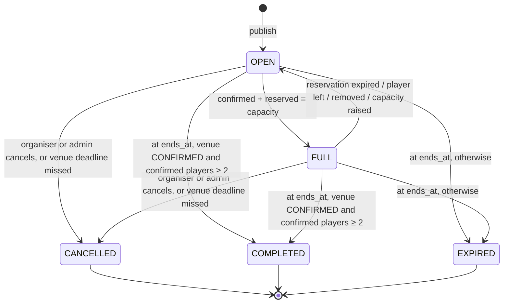
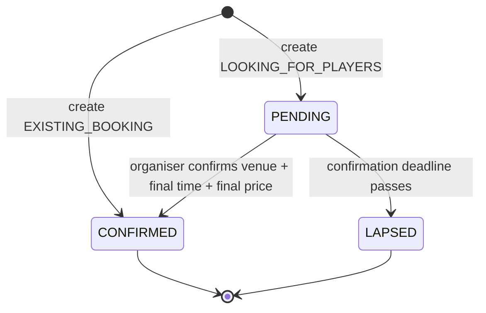
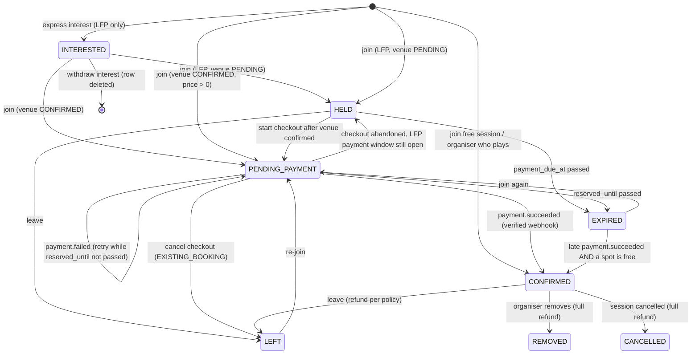

> ⚠️ **SUPERSEDED — historical reference only.** Archived 8 Nov 2026.
> This lifecycle combined participation with online payment (`HELD`, `PENDING_PAYMENT`, 15-minute reservations, 12-hour payment window). The MVP keeps participation and offline payment independent.
> Current document: [workflows/session-lifecycle.md](../workflows/session-lifecycle.md). Online-payment flows for a future release: [future/online-payments-stripe.md](../future/online-payments-stripe.md).

# 02 – Session and Participant Lifecycle

Three independent state dimensions are tracked:

| Dimension | Field | Owned by |
| --- | --- | --- |
| Session availability and lifecycle | `sessions.status` | sessions module (state machine) |
| Venue confirmation | `sessions.venue_confirmation_status` | sessions module |
| A player's place in a session | `session_participants.status` | participants module |
| A player's money | `payments.status` | payments module (see [payments](04-payments.md)) |

The payments module never writes session or participant rows directly. It emits domain events (`payment.succeeded`, `payment.failed`, `refund.succeeded`), and the participants module reacts inside its own transaction.

## 1. Session status

- `FULL` means **no spot can be taken right now**. It counts unpaid reservations, which is why it can return to `OPEN`.
- Every `CANCELLED` transition triggers automatic full refunds of all successful payments.
- `EXPIRED` means the game could not have happened as planned (venue never confirmed, or fewer than 2 confirmed players). If an expiring session holds any succeeded payment (e.g. a non-playing organiser with a single payer), the job refunds it in full and flags it in admin. No payout is ever created for an `EXPIRED` session.
- `COMPLETED` starts the **payout hold window** (default 48 h) during which players can report that the game did not happen.

## 2. Venue confirmation status

`LAPSED` always comes with session `CANCELLED` (reason `VENUE_NOT_CONFIRMED`). No money has been collected at that point, so nothing needs refunding.

**On confirmation** (one transaction):
1. Set venue (existing or new), final `starts_at`/`ends_at`, `total_cost_minor`; recompute `cost_per_player_minor`, service fee snapshot and coordinates (`location_precision = EXACT`).
2. Every `HELD` participant gets `payment_due_at = min(now + 12 h, starts_at − 2 h)`.
3. Notify holders ("Venue confirmed — pay AED 30 by 9 pm to keep your spot") and interested users ("Spots available").
4. If the final per-player price is more than 20% above the estimate, holders are told so explicitly; leaving at this point is always free.

## 3. Participant status

| Status | Holds a spot? | Counter |
| --- | --- | --- |
| `INTERESTED` | No | `interested_count` |
| `HELD` | Yes | `reserved_count` |
| `PENDING_PAYMENT` | Yes, until `reserved_until` | `reserved_count` |
| `CONFIRMED` | Yes | `confirmed_count` |
| `LEFT`, `REMOVED`, `EXPIRED`, `CANCELLED` | No | — |

`spots_left = capacity − confirmed_count − reserved_count`, enforced by a CHECK constraint (`confirmed_count + reserved_count ≤ capacity`).

### Late payment edge case
A provider can confirm a payment after our reservation expired (e.g. 3-D Secure took too long). The webhook handler then:
- confirms the player if a spot is still free, or
- issues an automatic full refund (`RESERVATION_EXPIRED`) and notifies the player.

A player is never confirmed beyond capacity, and money is never silently kept.

## 4. Timers (all configurable in admin → settings)

| Timer | Default | Enforced by |
| --- | --- | --- |
| Checkout reservation (`reserved_until`) | 15 min | sweeper job (every 30 s) + provider checkout expiry |
| LFP payment due window | 12 h after confirmation, ≥ 2 h before start | sweeper job |
| Venue confirmation deadline | 12 h before proposed start (organiser may set earlier) | scheduler |
| Join cut-off | at `starts_at` | API validation |
| Free leave window | ≥ 24 h before start | refund policy |
| Completion/expiry | at `ends_at` | scheduler |
| Payout hold | 48 h after `ends_at` | payout job |

All jobs use `SELECT … FOR UPDATE SKIP LOCKED`, so they're safe to run on several API instances.

## 5. Editing rules

| Change | Before any payment | After first successful payment |
| --- | --- | --- |
| Instructions, images, title, skill level | ✅ | ✅ (notify) |
| Capacity up | ✅ | ✅. Per-player price stays locked; the organiser collects more. |
| Capacity down | ✅ if ≥ confirmed + reserved | ✅ if ≥ confirmed + reserved |
| Date/time | ✅ (notify) | ✅. Confirmed players get a 24 h window to leave with a **full refund**. |
| Venue (EXISTING_BOOKING) | ✅ | Same as date/time |
| Total cost / price | ✅ | ❌ locked (`price_locked_at`) |
| Session type | ❌ never after publish | ❌ |
