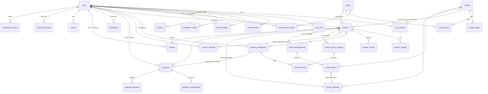

# Database Schema (MVP, offline payments)

PostgreSQL 16, Prisma migrations (DEC-042).

- Timestamps are UTC `TIMESTAMPTZ(3)`, displayed in Asia/Dubai (DEC-001).
- Money is integer **fils** (`*_fils`) with `currency CHAR(3) = 'AED'` (DEC-019).
- IDs are UUID v7 `CHAR(36)` (ARC-002).
- **No Stripe, checkout, payout, provider-notification or wallet tables** (DEC-017, DEC-021). Their future design is in [future/online-payments-stripe.md](../future/online-payments-stripe.md).
- This draft hasn't been run through `prisma validate` after the offline-payment rewrite. Validating it is the first database task in Phase 2.

## 1. Entity relationship diagram



## 2. Prisma schema (draft)

This moves to `apps/api/prisma/schema.prisma` in Phase 2.

```prisma
generator client {
  provider = "prisma-client-js"
}

datasource db {
  provider = "postgresql"
  url      = env("DATABASE_URL")
}

// ═════════════ Enums ═════════════

enum UserRole {
  USER
  SUPPORT
  OPERATIONS
  SUPER_ADMIN
}

enum UserStatus {
  ACTIVE
  SUSPENDED
  DELETED
}

enum AuthProvider {
  GOOGLE
  APPLE
}

enum SkillLevel {
  BEGINNER
  INTERMEDIATE
  ADVANCED
  PROFESSIONAL
}

enum VerificationPurpose {
  EMAIL_VERIFY
  EMAIL_CHANGE
  PASSWORD_RESET
  PHONE_VERIFY
}

enum DevicePlatform {
  IOS
  ANDROID
  WEB
}

enum SessionType {
  EXISTING_BOOKING
  LOOKING_FOR_PLAYERS
}

enum SessionStatus {
  OPEN
  FULL
  CANCELLED
  COMPLETED
  EXPIRED
}

enum VenueConfirmationStatus {
  PENDING
  CONFIRMED
  LAPSED
}

enum LocationPrecision {
  EXACT
  AREA
}

enum SessionVisibility {
  PUBLIC
  UNLISTED
}

enum SessionCancellationReason {
  ORGANISER_CANCELLED
  ADMIN_CANCELLED
  VENUE_NOT_CONFIRMED
  MINIMUM_NOT_MET_ORGANISER_CANCELLED
  MINIMUM_NOT_MET_NO_DECISION
  ORGANISER_ACCOUNT_DELETED
}

enum MinPlayersDecision {
  PROCEED
  CANCEL
}

enum ParticipantRole {
  ORGANISER
  PLAYER
}

enum ParticipantStatus {
  CONFIRMED
  CANCELLED
  ATTENDED
  NO_SHOW
}

enum ParticipantCancellationReason {
  LEFT
  REMOVED_BY_ORGANISER
  REMOVED_BY_ADMIN
  SESSION_CANCELLED
  PRICE_REJECTED
  PRICE_NOT_ACCEPTED
}

enum PriceConsentStatus {
  PENDING
  ACCEPTED
  REJECTED
  EXPIRED
  SUPERSEDED
}

enum VenueArrangementStatus {
  REQUESTED
  IN_PROGRESS
  OPTIONS_PROPOSED
  APPROVED
  BOOKED
  UNSUCCESSFUL
  CANCELLED
}

enum VenueOptionStatus {
  PROPOSED
  APPROVED
  REJECTED
  WITHDRAWN
  EXPIRED
}

enum VenuePaymentStatus {
  NOT_PAID
  PAID
}

enum PaymentStatus {
  UNPAID
  PAYMENT_REPORTED
  PAID
  PAYMENT_DISPUTED
  WAIVED
  REFUNDED
}

enum PaymentMethod {
  CASH
  BANK_TRANSFER
  PAYMENT_APP
  OTHER
}

enum PaymentActorRole {
  PLAYER
  ORGANISER
  ADMIN
  SYSTEM
}

enum PaymentAction {
  REPORTED_BY_PLAYER
  REPORT_RETRACTED
  CONFIRMED_BY_ORGANISER
  CONFIRMED_BY_ADMIN
  REPORT_REJECTED
  WAIVED
  REFUND_RECORDED
  AMOUNT_CHANGED
  DISPUTE_OPENED
  DISPUTE_RESOLVED
  DISPUTE_WITHDRAWN
  STATUS_CORRECTED
}

enum PaymentDisputeReason {
  PAYMENT_NOT_RECEIVED
  PAYMENT_NOT_ACKNOWLEDGED
  REFUND_NOT_RECEIVED
  AMOUNT_INCORRECT
  OTHER
}

enum PaymentDisputeStatus {
  OPEN
  RESOLVED
  WITHDRAWN
}

enum NotificationType {
  PLAYER_JOINED
  PLAYER_LEFT
  PLAYER_REMOVED
  SESSION_FULL
  SESSION_REOPENED
  SESSION_JOINABLE
  SESSION_UPDATED
  SESSION_CANCELLED
  SESSION_REMINDER
  PRICE_CHANGED
  PRICE_CONSENT_REQUIRED
  PRICE_CONSENT_REMINDER
  MIN_PLAYERS_DECISION_REQUIRED
  VENUE_OPTIONS_PROPOSED
  VENUE_CONFIRMED
  VENUE_DEADLINE_APPROACHING
  PAYMENT_REPORTED
  PAYMENT_CONFIRMED
  PAYMENT_WAIVED
  REFUND_RECORDED
  PAYMENT_DISPUTED
  PAYMENT_DISPUTE_RESOLVED
  PAYMENT_REMINDER
  REVIEW_RECEIVED
}

enum ReportTargetType {
  USER
  SESSION
  REVIEW
}

enum ReportStatus {
  OPEN
  ACTIONED
  DISMISSED
}

// ═════════════ Identity ═════════════

model User {
  id              String     @id @default(uuid(7)) @db.Char(36)
  email           String     @unique @db.VarChar(191)
  passwordHash    String?    @map("password_hash") @db.VarChar(255)   // null for social-only accounts
  phone           String?    @unique @db.VarChar(20)                  // E.164
  phoneVerifiedAt DateTime?  @map("phone_verified_at") @db.DateTime(3)
  emailVerifiedAt DateTime?  @map("email_verified_at") @db.DateTime(3)
  role            UserRole   @default(USER)
  status          UserStatus @default(ACTIVE)
  lastLoginAt     DateTime?  @map("last_login_at") @db.DateTime(3)
  createdAt       DateTime   @default(now()) @map("created_at") @db.DateTime(3)
  updatedAt       DateTime   @updatedAt @map("updated_at") @db.DateTime(3)
  deletedAt       DateTime?  @map("deleted_at") @db.DateTime(3)

  profile               UserProfile?
  mfa                   UserMfa?
  identities            AuthIdentity[]
  refreshTokens         RefreshToken[]
  verificationCodes     VerificationCode[]
  devices               Device[]
  favouriteSports       UserFavouriteSport[]
  venuesCreated         Venue[]               @relation("VenueCreatedBy")
  organisedSessions     Session[]             @relation("SessionOrganiser")
  participations        SessionParticipant[]  @relation("ParticipantUser")
  attendanceMarked      SessionParticipant[]  @relation("AttendanceMarkedBy")
  interests             SessionInterest[]
  sessionEvents         SessionEvent[]
  priceChangesMade      SessionPriceChange[]
  arrangementsAssigned  VenueArrangement[]    @relation("ArrangementAssignee")
  venueOptionsProposed  VenueOption[]
  venueBookingsRecorded VenueBooking[]
  paymentsAsPayer       Payment[]             @relation("PaymentPayer")
  paymentsAsPayee       Payment[]             @relation("PaymentPayee")
  paymentActions        PaymentConfirmation[]
  disputesOpened        PaymentDispute[]      @relation("DisputeOpenedBy")
  disputesResolved      PaymentDispute[]      @relation("DisputeResolvedBy")
  notifications         Notification[]        @relation("NotificationRecipient")
  notificationsActed    Notification[]        @relation("NotificationActor")
  reviewsWritten        Review[]              @relation("Reviewer")
  reviewsReceived       Review[]              @relation("Reviewee")
  reportsFiled          Report[]              @relation("Reporter")
  reportsResolved       Report[]              @relation("ReportResolver")
  adminActions          AdminAuditLog[]
  idempotencyKeys       IdempotencyKey[]
  settingsUpdated       PlatformSetting[]

  @@index([role])
  @@map("users")
}

model AuthIdentity {
  id             String       @id @default(uuid(7)) @db.Char(36)
  userId         String       @map("user_id") @db.Char(36)
  provider       AuthProvider
  providerUserId String       @map("provider_user_id") @db.VarChar(255)
  email          String?      @db.VarChar(191)                       // may be an Apple private-relay address
  createdAt      DateTime     @default(now()) @map("created_at") @db.DateTime(3)

  user User @relation(fields: [userId], references: [id], onDelete: Cascade)

  @@unique([provider, providerUserId])
  @@index([userId])
  @@map("auth_identities")
}

model UserProfile {
  userId            String   @id @map("user_id") @db.Char(36)
  displayName       String   @map("display_name") @db.VarChar(60)
  avatarUrl         String?  @map("avatar_url") @db.VarChar(500)    // Cloudinary
  bio               String?  @db.VarChar(280)
  homeAreaLabel     String?  @map("home_area_label") @db.VarChar(120)
  homeLatitude      Decimal? @map("home_latitude") @db.Decimal(5, 2)   // coarse (~1 km), private
  homeLongitude     Decimal? @map("home_longitude") @db.Decimal(5, 2)
  defaultRadiusKm   Int      @default(5) @map("default_radius_km") @db.SmallInt
  notificationPrefs Json?    @map("notification_prefs")
  ratingAvg         Decimal  @default(0) @map("rating_avg") @db.Decimal(3, 2)
  ratingCount       Int      @default(0) @map("rating_count")
  updatedAt         DateTime @updatedAt @map("updated_at") @db.DateTime(3)

  user User @relation(fields: [userId], references: [id], onDelete: Cascade)

  @@map("user_profiles")
}

model UserMfa {
  userId        String    @id @map("user_id") @db.Char(36)
  totpSecretEnc String    @map("totp_secret_enc") @db.VarChar(255)   // encrypted at rest
  enabledAt     DateTime? @map("enabled_at") @db.DateTime(3)
  recoveryCodes Json      @map("recovery_codes")                     // hashed, single use
  failedCount   Int       @default(0) @map("failed_count") @db.SmallInt
  lockedUntil   DateTime? @map("locked_until") @db.DateTime(3)

  user User @relation(fields: [userId], references: [id], onDelete: Cascade)

  @@map("user_mfa")
}

model RefreshToken {
  id           String    @id @default(uuid(7)) @db.Char(36)
  userId       String    @map("user_id") @db.Char(36)
  tokenHash    String    @unique @map("token_hash") @db.Char(64)
  familyId     String    @map("family_id") @db.Char(36)
  replacedById String?   @map("replaced_by_id") @db.Char(36)
  audience     String    @default("app") @db.VarChar(10)               // app | admin
  userAgent    String?   @map("user_agent") @db.VarChar(255)
  expiresAt    DateTime  @map("expires_at") @db.DateTime(3)
  revokedAt    DateTime? @map("revoked_at") @db.DateTime(3)
  createdAt    DateTime  @default(now()) @map("created_at") @db.DateTime(3)

  user User @relation(fields: [userId], references: [id], onDelete: Cascade)

  @@index([userId])
  @@index([familyId])
  @@map("refresh_tokens")
}

model VerificationCode {
  id         String              @id @default(uuid(7)) @db.Char(36)
  userId     String              @map("user_id") @db.Char(36)
  purpose    VerificationPurpose
  target     String?             @db.VarChar(191)                  // phone or new email being verified
  codeHash   String              @map("code_hash") @db.Char(64)
  attempts   Int                 @default(0) @db.TinyInt
  expiresAt  DateTime            @map("expires_at") @db.DateTime(3)
  consumedAt DateTime?           @map("consumed_at") @db.DateTime(3)
  createdAt  DateTime            @default(now()) @map("created_at") @db.DateTime(3)

  user User @relation(fields: [userId], references: [id], onDelete: Cascade)

  @@index([userId, purpose])
  @@map("verification_codes")
}

model Device {
  id         String         @id @default(uuid(7)) @db.Char(36)
  userId     String         @map("user_id") @db.Char(36)
  platform   DevicePlatform
  pushToken  String         @unique @map("push_token") @db.VarChar(255)
  lastSeenAt DateTime       @default(now()) @map("last_seen_at") @db.DateTime(3)

  user User @relation(fields: [userId], references: [id], onDelete: Cascade)

  @@index([userId])
  @@map("devices")
}

// ═════════════ Catalogue ═════════════

model Sport {
  id             Int     @id @default(autoincrement())
  slug           String  @unique @db.VarChar(40)
  name           String  @db.VarChar(60)
  iconKey        String  @map("icon_key") @db.VarChar(40)
  accentColor    String  @map("accent_color") @db.Char(7)
  minPlayers     Int     @map("min_players") @db.SmallInt       // sport-level minimum (DEC-026)
  maxPlayers     Int     @map("max_players") @db.SmallInt
  defaultPlayers Int     @map("default_players") @db.SmallInt
  isActive       Boolean @default(true) @map("is_active")
  sortOrder      Int     @default(0) @map("sort_order") @db.SmallInt

  sessions     Session[]
  venueSports  VenueSport[]
  favouritedBy UserFavouriteSport[]

  @@map("sports")
}

model UserFavouriteSport {
  userId     String     @map("user_id") @db.Char(36)
  sportId    Int        @map("sport_id")
  skillLevel SkillLevel @default(INTERMEDIATE) @map("skill_level")

  user  User  @relation(fields: [userId], references: [id], onDelete: Cascade)
  sport Sport @relation(fields: [sportId], references: [id])

  @@id([userId, sportId])
  @@index([sportId])
  @@map("user_favourite_sports")
}

// ═════════════ Venues ═════════════

model Venue {
  id             String   @id @default(uuid(7)) @db.Char(36)
  googlePlaceId  String?  @unique @map("google_place_id") @db.VarChar(255)
  name           String   @db.VarChar(120)
  addressLine    String   @map("address_line") @db.VarChar(255)
  area           String?  @db.VarChar(120)
  city           String   @db.VarChar(80)
  countryCode    String   @default("AE") @map("country_code") @db.Char(2)
  latitude       Decimal  @db.Decimal(9, 6)
  longitude      Decimal  @db.Decimal(9, 6)
  timezone       String   @default("Asia/Dubai") @db.VarChar(64)
  isVerified     Boolean  @default(false) @map("is_verified")
  contactPhone   String?  @map("contact_phone") @db.VarChar(20)      // staff-only
  contactEmail   String?  @map("contact_email") @db.VarChar(191)     // staff-only
  bookingChannel String?  @map("booking_channel") @db.VarChar(255)   // staff-only, e.g. "WhatsApp", URL
  staffNotes     String?  @map("staff_notes") @db.Text               // staff-only
  mergedIntoId   String?  @map("merged_into_id") @db.Char(36)
  createdById    String?  @map("created_by_id") @db.Char(36)
  createdAt      DateTime @default(now()) @map("created_at") @db.DateTime(3)
  updatedAt      DateTime @updatedAt @map("updated_at") @db.DateTime(3)

  createdBy User?          @relation("VenueCreatedBy", fields: [createdById], references: [id], onDelete: SetNull)
  sports    VenueSport[]
  images    VenueImage[]
  sessions  Session[]
  options   VenueOption[]
  bookings  VenueBooking[]

  @@index([latitude, longitude])
  @@index([city])
  @@map("venues")
}

model VenueSport {
  venueId String @map("venue_id") @db.Char(36)
  sportId Int    @map("sport_id")

  venue Venue @relation(fields: [venueId], references: [id], onDelete: Cascade)
  sport Sport @relation(fields: [sportId], references: [id])

  @@id([venueId, sportId])
  @@index([sportId])
  @@map("venue_sports")
}

model VenueImage {
  id         String   @id @default(uuid(7)) @db.Char(36)
  venueId    String   @map("venue_id") @db.Char(36)
  url        String   @db.VarChar(500)
  publicId   String   @map("public_id") @db.VarChar(255)            // Cloudinary public ID
  sortOrder  Int      @default(0) @map("sort_order") @db.SmallInt
  createdAt  DateTime @default(now()) @map("created_at") @db.DateTime(3)

  venue Venue @relation(fields: [venueId], references: [id], onDelete: Cascade)

  @@index([venueId])
  @@map("venue_images")
}

// ═════════════ Sessions ═════════════

model Session {
  id                         String                     @id @default(uuid(7)) @db.Char(36)
  organiserId                String                     @map("organiser_id") @db.Char(36)
  sportId                    Int                        @map("sport_id")
  sessionType                SessionType                @map("session_type")
  status                     SessionStatus              @default(OPEN)
  venueConfirmationStatus    VenueConfirmationStatus    @map("venue_confirmation_status")
  visibility                 SessionVisibility          @default(PUBLIC)

  // where
  venueId                    String?                    @map("venue_id") @db.Char(36)
  preferredAreaLabel         String?                    @map("preferred_area_label") @db.VarChar(120)
  preferredAreaPlaceId       String?                    @map("preferred_area_place_id") @db.VarChar(255)
  areaRadiusKm               Decimal?                   @map("area_radius_km") @db.Decimal(4, 1)
  latitude                   Decimal                    @db.Decimal(9, 6)     // venue or area centroid
  longitude                  Decimal                    @db.Decimal(9, 6)
  locationPrecision          LocationPrecision          @map("location_precision")
  timezone                   String                     @default("Asia/Dubai") @db.VarChar(64)

  // when (preferred times while venue PENDING)
  startsAt                   DateTime                   @map("starts_at") @db.DateTime(3)
  endsAt                     DateTime                   @map("ends_at") @db.DateTime(3)
  venueConfirmDeadline       DateTime?                  @map("venue_confirm_deadline") @db.DateTime(3)
  venueConfirmedAt           DateTime?                  @map("venue_confirmed_at") @db.DateTime(3)

  // who
  capacity                   Int                        @db.SmallInt          // max players incl. organiser if participating
  minPlayers                 Int?                       @map("min_players") @db.SmallInt
  minPlayersDecisionDeadline DateTime?                  @map("min_players_decision_deadline") @db.DateTime(3)
  minPlayersDecision         MinPlayersDecision?        @map("min_players_decision")
  minPlayersDecidedAt        DateTime?                  @map("min_players_decided_at") @db.DateTime(3)
  organiserIsPlaying         Boolean                    @default(true) @map("organiser_is_playing")
  confirmedCount             Int                        @default(0) @map("confirmed_count") @db.SmallInt
  interestedCount            Int                        @default(0) @map("interested_count") @db.SmallInt
  skillLevel                 SkillLevel?                @map("skill_level")

  // money (fils)
  currency                   String                     @default("AED") @db.Char(3)
  estimatedTotalCostFils     Int?                       @map("estimated_total_cost_fils")
  estimatedShareMaxFils      Int?                       @map("estimated_share_max_fils")   // largest share, for display/filter
  totalCostFils              Int?                       @map("total_cost_fils")            // required once venue CONFIRMED
  shareMaxFils               Int?                       @map("share_max_fils")             // largest share, for display/filter

  // content
  title                      String?                    @db.VarChar(100)
  instructions               String?                    @db.Text

  // lifecycle
  cancelledAt                DateTime?                  @map("cancelled_at") @db.DateTime(3)
  cancellationReason         SessionCancellationReason? @map("cancellation_reason")
  cancellationNote           String?                    @map("cancellation_note") @db.VarChar(280)
  closedAt                   DateTime?                  @map("closed_at") @db.DateTime(3)    // COMPLETED / EXPIRED
  version                    Int                        @default(0)
  createdAt                  DateTime                   @default(now()) @map("created_at") @db.DateTime(3)
  updatedAt                  DateTime                   @updatedAt @map("updated_at") @db.DateTime(3)

  organiser     User                 @relation("SessionOrganiser", fields: [organiserId], references: [id])
  sport         Sport                @relation(fields: [sportId], references: [id])
  venue         Venue?               @relation(fields: [venueId], references: [id], onDelete: Restrict, onUpdate: Restrict)
  participants  SessionParticipant[]
  interests     SessionInterest[]
  images        SessionImage[]
  events        SessionEvent[]
  priceChanges  SessionPriceChange[]
  arrangement   VenueArrangement?
  booking       VenueBooking?
  payments      Payment[]
  notifications Notification[]
  reviews       Review[]

  @@index([status, startsAt])
  @@index([latitude, longitude])
  @@index([sportId, status, startsAt])
  @@index([organiserId, startsAt])
  @@index([venueId, startsAt])
  @@index([venueConfirmationStatus, venueConfirmDeadline])
  @@index([status, minPlayersDecisionDeadline])
  @@index([status, endsAt])
  @@map("sessions")
}

model SessionParticipant {
  id                   String                         @id @default(uuid(7)) @db.Char(36)
  sessionId            String                         @map("session_id") @db.Char(36)
  userId               String                         @map("user_id") @db.Char(36)
  role                 ParticipantRole                @default(PLAYER)
  status               ParticipantStatus
  shareSlot            Int?                           @map("share_slot") @db.SmallInt   // null when CANCELLED
  cancellationReason   ParticipantCancellationReason? @map("cancellation_reason")
  joinedAt             DateTime                       @default(now()) @map("joined_at") @db.DateTime(3)
  cancelledAt          DateTime?                      @map("cancelled_at") @db.DateTime(3)
  attendanceMarkedAt   DateTime?                      @map("attendance_marked_at") @db.DateTime(3)
  attendanceMarkedById String?                        @map("attendance_marked_by_id") @db.Char(36)
  updatedAt            DateTime                       @updatedAt @map("updated_at") @db.DateTime(3)

  session            Session         @relation(fields: [sessionId], references: [id], onDelete: Cascade)
  user               User            @relation("ParticipantUser", fields: [userId], references: [id])
  attendanceMarkedBy User?           @relation("AttendanceMarkedBy", fields: [attendanceMarkedById], references: [id], onDelete: SetNull)
  payment            Payment?
  priceConsents      PriceConsent[]

  @@unique([sessionId, userId])
  @@unique([sessionId, shareSlot])     // one participant per slot; NULLs allowed
  @@index([userId, status])
  @@index([sessionId, status])
  @@map("session_participants")
}

/// Interest in a LOOKING_FOR_PLAYERS session before its venue is confirmed (pending O-01). Holds no spot.
model SessionInterest {
  sessionId String   @map("session_id") @db.Char(36)
  userId    String   @map("user_id") @db.Char(36)
  createdAt DateTime @default(now()) @map("created_at") @db.DateTime(3)

  session Session @relation(fields: [sessionId], references: [id], onDelete: Cascade)
  user    User    @relation(fields: [userId], references: [id], onDelete: Cascade)

  @@id([sessionId, userId])
  @@index([userId])
  @@map("session_interests")
}

model SessionImage {
  id        String   @id @default(uuid(7)) @db.Char(36)
  sessionId String   @map("session_id") @db.Char(36)
  url       String   @db.VarChar(500)
  publicId  String   @map("public_id") @db.VarChar(255)
  sortOrder Int      @default(0) @map("sort_order") @db.SmallInt
  createdAt DateTime @default(now()) @map("created_at") @db.DateTime(3)

  session Session @relation(fields: [sessionId], references: [id], onDelete: Cascade)

  @@index([sessionId])
  @@map("session_images")
}

/// Append-only timeline (status changes, edits, venue steps) for support and admin.
model SessionEvent {
  id        String   @id @default(uuid(7)) @db.Char(36)
  sessionId String   @map("session_id") @db.Char(36)
  actorId   String?  @map("actor_id") @db.Char(36)                // null = system job
  type      String   @db.VarChar(60)
  data      Json?
  createdAt DateTime @default(now()) @map("created_at") @db.DateTime(3)

  session Session @relation(fields: [sessionId], references: [id], onDelete: Cascade)
  actor   User?   @relation(fields: [actorId], references: [id], onDelete: SetNull)

  @@index([sessionId, createdAt])
  @@map("session_events")
}

model SessionPriceChange {
  id                String    @id @default(uuid(7)) @db.Char(36)
  sessionId         String    @map("session_id") @db.Char(36)
  createdById       String    @map("created_by_id") @db.Char(36)
  previousTotalFils Int       @map("previous_total_fils")
  newTotalFils      Int       @map("new_total_fils")
  previousCapacity  Int       @map("previous_capacity") @db.SmallInt
  newCapacity       Int       @map("new_capacity") @db.SmallInt
  reason            String?   @db.VarChar(280)
  consentDeadline   DateTime? @map("consent_deadline") @db.DateTime(3)   // when any consent is required
  createdAt         DateTime  @default(now()) @map("created_at") @db.DateTime(3)

  session   Session        @relation(fields: [sessionId], references: [id], onDelete: Cascade)
  createdBy User           @relation(fields: [createdById], references: [id])
  consents  PriceConsent[]

  @@index([sessionId, createdAt])
  @@map("session_price_changes")
}

/// One row per participant whose share rises by more than the threshold (DEC-031).
model PriceConsent {
  id                 String             @id @default(uuid(7)) @db.Char(36)
  priceChangeId      String             @map("price_change_id") @db.Char(36)
  participantId      String             @map("participant_id") @db.Char(36)
  previousAmountFils Int                @map("previous_amount_fils")
  newAmountFils      Int                @map("new_amount_fils")
  status             PriceConsentStatus @default(PENDING)
  respondedAt        DateTime?          @map("responded_at") @db.DateTime(3)
  createdAt          DateTime           @default(now()) @map("created_at") @db.DateTime(3)

  priceChange SessionPriceChange @relation(fields: [priceChangeId], references: [id], onDelete: Cascade)
  participant SessionParticipant @relation(fields: [participantId], references: [id], onDelete: Cascade)

  @@unique([priceChangeId, participantId])
  @@index([participantId, status])
  @@index([status, createdAt])
  @@map("price_consents")
}

// ═════════════ Venue coordination ═════════════

model VenueArrangement {
  id           String                 @id @default(uuid(7)) @db.Char(36)
  sessionId    String                 @unique @map("session_id") @db.Char(36)
  status       VenueArrangementStatus @default(REQUESTED)
  assignedToId String?                @map("assigned_to_id") @db.Char(36)
  staffNotes   String?                @map("staff_notes") @db.Text      // staff-only
  closedReason String?                @map("closed_reason") @db.VarChar(280)
  createdAt    DateTime               @default(now()) @map("created_at") @db.DateTime(3)
  updatedAt    DateTime               @updatedAt @map("updated_at") @db.DateTime(3)

  session    Session       @relation(fields: [sessionId], references: [id], onDelete: Cascade)
  assignedTo User?         @relation("ArrangementAssignee", fields: [assignedToId], references: [id], onDelete: SetNull)
  options    VenueOption[]

  @@index([status, createdAt])
  @@index([assignedToId, status])
  @@map("venue_arrangements")
}

model VenueOption {
  id             String            @id @default(uuid(7)) @db.Char(36)
  arrangementId  String            @map("arrangement_id") @db.Char(36)
  venueId        String            @map("venue_id") @db.Char(36)
  startsAt       DateTime          @map("starts_at") @db.DateTime(3)
  endsAt         DateTime          @map("ends_at") @db.DateTime(3)
  totalCostFils  Int               @map("total_cost_fils")
  notes          String?           @db.VarChar(500)
  validUntil     DateTime?         @map("valid_until") @db.DateTime(3)
  status         VenueOptionStatus @default(PROPOSED)
  proposedById   String            @map("proposed_by_id") @db.Char(36)
  decidedAt      DateTime?         @map("decided_at") @db.DateTime(3)
  createdAt      DateTime          @default(now()) @map("created_at") @db.DateTime(3)

  arrangement VenueArrangement @relation(fields: [arrangementId], references: [id], onDelete: Cascade)
  venue       Venue            @relation(fields: [venueId], references: [id])
  proposedBy  User             @relation(fields: [proposedById], references: [id])
  booking     VenueBooking?

  @@index([arrangementId, status])
  @@map("venue_options")
}

/// Recorded venue booking for a confirmed session (both types). PlayAround never pays the venue.
model VenueBooking {
  id                 String             @id @default(uuid(7)) @db.Char(36)
  sessionId          String             @unique @map("session_id") @db.Char(36)
  venueId            String             @map("venue_id") @db.Char(36)
  venueOptionId      String?            @unique @map("venue_option_id") @db.Char(36)   // LFP approved option
  startsAt           DateTime           @map("starts_at") @db.DateTime(3)
  endsAt             DateTime           @map("ends_at") @db.DateTime(3)
  totalCostFils      Int                @map("total_cost_fils")
  bookingReference   String?            @map("booking_reference") @db.VarChar(80)       // optional (DEC-030)
  venuePaymentStatus VenuePaymentStatus @default(NOT_PAID) @map("venue_payment_status")
  venuePaidAt        DateTime?          @map("venue_paid_at") @db.DateTime(3)
  recordedById       String             @map("recorded_by_id") @db.Char(36)
  createdAt          DateTime           @default(now()) @map("created_at") @db.DateTime(3)
  updatedAt          DateTime           @updatedAt @map("updated_at") @db.DateTime(3)

  session     Session      @relation(fields: [sessionId], references: [id], onDelete: Cascade)
  venue       Venue        @relation(fields: [venueId], references: [id])
  venueOption VenueOption? @relation(fields: [venueOptionId], references: [id])
  recordedBy  User         @relation(fields: [recordedById], references: [id])

  @@index([venueId, startsAt])
  @@map("venue_bookings")
}

// ═════════════ Offline payment records ═════════════

/// One per paying participation. Records only; no money moves through PlayAround (DEC-012).
model Payment {
  id                 String         @id @default(uuid(7)) @db.Char(36)
  sessionId          String         @map("session_id") @db.Char(36)
  participantId      String         @unique @map("participant_id") @db.Char(36)
  payerId            String         @map("payer_id") @db.Char(36)       // player
  payeeId            String         @map("payee_id") @db.Char(36)       // organiser
  status             PaymentStatus  @default(UNPAID)
  currency           String         @default("AED") @db.Char(3)
  amountDueFils      Int            @map("amount_due_fils")
  agreedAmountFils   Int            @map("agreed_amount_fils")
  amountPaidFils     Int            @default(0) @map("amount_paid_fils")
  refundedAmountFils Int            @default(0) @map("refunded_amount_fils")
  lastMethod         PaymentMethod? @map("last_method")
  lastReference      String?        @map("last_reference") @db.VarChar(80)
  reportedAt         DateTime?      @map("reported_at") @db.DateTime(3)
  paidAt             DateTime?      @map("paid_at") @db.DateTime(3)
  waivedAt           DateTime?      @map("waived_at") @db.DateTime(3)
  refundedAt         DateTime?      @map("refunded_at") @db.DateTime(3)
  version            Int            @default(0)
  createdAt          DateTime       @default(now()) @map("created_at") @db.DateTime(3)
  updatedAt          DateTime       @updatedAt @map("updated_at") @db.DateTime(3)

  session       Session               @relation(fields: [sessionId], references: [id], onDelete: Cascade)
  participant   SessionParticipant    @relation(fields: [participantId], references: [id], onDelete: Cascade)
  payer         User                  @relation("PaymentPayer", fields: [payerId], references: [id])
  payee         User                  @relation("PaymentPayee", fields: [payeeId], references: [id])
  confirmations PaymentConfirmation[]
  disputes      PaymentDispute[]

  @@index([sessionId, status])
  @@index([payerId, status])
  @@index([payeeId, status])
  @@map("payments")
}

/// Append-only log of every payment action (report, confirm, waive, refund, dispute, correction).
model PaymentConfirmation {
  id         String           @id @default(uuid(7)) @db.Char(36)
  paymentId  String           @map("payment_id") @db.Char(36)
  actorId    String?          @map("actor_id") @db.Char(36)          // null when SYSTEM
  actorRole  PaymentActorRole @map("actor_role")
  action     PaymentAction
  fromStatus PaymentStatus?   @map("from_status")
  toStatus   PaymentStatus    @map("to_status")
  amountFils Int?             @map("amount_fils")
  method     PaymentMethod?
  reference  String?          @db.VarChar(80)
  note       String?          @db.VarChar(500)
  createdAt  DateTime         @default(now()) @map("created_at") @db.DateTime(3)

  payment Payment @relation(fields: [paymentId], references: [id], onDelete: Cascade)
  actor   User?   @relation(fields: [actorId], references: [id], onDelete: SetNull)

  @@index([paymentId, createdAt])
  @@map("payment_confirmations")
}

model PaymentDispute {
  id                  String               @id @default(uuid(7)) @db.Char(36)
  paymentId           String               @map("payment_id") @db.Char(36)
  openedById          String               @map("opened_by_id") @db.Char(36)
  reason              PaymentDisputeReason
  description         String?              @db.VarChar(1000)
  status              PaymentDisputeStatus @default(OPEN)
  statusBeforeDispute PaymentStatus        @map("status_before_dispute")
  resolutionStatus    PaymentStatus?       @map("resolution_status")
  resolutionNote      String?              @map("resolution_note") @db.VarChar(1000)
  resolvedById        String?              @map("resolved_by_id") @db.Char(36)
  openLock            String?              @unique @map("open_lock") @db.Char(36)   // = payment_id while OPEN
  createdAt           DateTime             @default(now()) @map("created_at") @db.DateTime(3)
  resolvedAt          DateTime?            @map("resolved_at") @db.DateTime(3)

  payment    Payment @relation(fields: [paymentId], references: [id], onDelete: Cascade)
  openedBy   User    @relation("DisputeOpenedBy", fields: [openedById], references: [id])
  resolvedBy User?   @relation("DisputeResolvedBy", fields: [resolvedById], references: [id], onDelete: SetNull)

  @@index([status, createdAt])
  @@index([paymentId])
  @@map("payment_disputes")
}

// ═════════════ Engagement ═════════════

model Notification {
  id         String           @id @default(uuid(7)) @db.Char(36)
  userId     String           @map("user_id") @db.Char(36)
  type       NotificationType
  title      String           @db.VarChar(120)
  body       String           @db.VarChar(500)
  entityType String?          @map("entity_type") @db.VarChar(30)   // session | payment | venue_arrangement | (future) conversation
  entityId   String?          @map("entity_id") @db.Char(36)
  sessionId  String?          @map("session_id") @db.Char(36)
  actorId    String?          @map("actor_id") @db.Char(36)
  data       Json?
  readAt     DateTime?        @map("read_at") @db.DateTime(3)
  pushedAt   DateTime?        @map("pushed_at") @db.DateTime(3)
  createdAt  DateTime         @default(now()) @map("created_at") @db.DateTime(3)

  user    User     @relation("NotificationRecipient", fields: [userId], references: [id], onDelete: Cascade)
  actor   User?    @relation("NotificationActor", fields: [actorId], references: [id], onDelete: SetNull)
  session Session? @relation(fields: [sessionId], references: [id], onDelete: SetNull)

  @@index([userId, createdAt])
  @@index([userId, readAt])
  @@map("notifications")
}

model Review {
  id         String   @id @default(uuid(7)) @db.Char(36)
  sessionId  String   @map("session_id") @db.Char(36)
  reviewerId String   @map("reviewer_id") @db.Char(36)
  revieweeId String   @map("reviewee_id") @db.Char(36)
  rating     Int      @db.TinyInt
  comment    String?  @db.VarChar(500)
  isHidden   Boolean  @default(false) @map("is_hidden")
  createdAt  DateTime @default(now()) @map("created_at") @db.DateTime(3)

  session  Session @relation(fields: [sessionId], references: [id], onDelete: Cascade)
  reviewer User    @relation("Reviewer", fields: [reviewerId], references: [id])
  reviewee User    @relation("Reviewee", fields: [revieweeId], references: [id])

  @@unique([sessionId, reviewerId, revieweeId])
  @@index([revieweeId, createdAt])
  @@map("reviews")
}

model Report {
  id           String           @id @default(uuid(7)) @db.Char(36)
  reporterId   String           @map("reporter_id") @db.Char(36)
  targetType   ReportTargetType @map("target_type")
  targetId     String           @map("target_id") @db.Char(36)
  reason       String           @db.VarChar(60)
  details      String?          @db.VarChar(1000)
  status       ReportStatus     @default(OPEN)
  resolvedById String?          @map("resolved_by_id") @db.Char(36)
  resolution   String?          @db.VarChar(500)
  createdAt    DateTime         @default(now()) @map("created_at") @db.DateTime(3)
  resolvedAt   DateTime?        @map("resolved_at") @db.DateTime(3)

  reporter   User  @relation("Reporter", fields: [reporterId], references: [id])
  resolvedBy User? @relation("ReportResolver", fields: [resolvedById], references: [id], onDelete: SetNull)

  @@index([status, createdAt])
  @@index([targetType, targetId])
  @@map("reports")
}

// ═════════════ Platform ═════════════

model IdempotencyKey {
  id           String   @id @default(uuid(7)) @db.Char(36)
  userId       String   @map("user_id") @db.Char(36)
  key          String   @db.VarChar(64)
  method       String   @db.VarChar(8)
  path         String   @db.VarChar(255)
  requestHash  String   @map("request_hash") @db.Char(64)
  statusCode   Int?     @map("status_code") @db.SmallInt
  responseBody Json?    @map("response_body")
  lockedUntil  DateTime @map("locked_until") @db.DateTime(3)
  expiresAt    DateTime @map("expires_at") @db.DateTime(3)
  createdAt    DateTime @default(now()) @map("created_at") @db.DateTime(3)

  user User @relation(fields: [userId], references: [id], onDelete: Cascade)

  @@unique([userId, key])
  @@index([expiresAt])
  @@map("idempotency_keys")
}

model PlatformSetting {
  key         String   @id @db.VarChar(80)
  value       Json
  updatedById String?  @map("updated_by_id") @db.Char(36)
  updatedAt   DateTime @updatedAt @map("updated_at") @db.DateTime(3)

  updatedBy User? @relation(fields: [updatedById], references: [id], onDelete: SetNull)

  @@map("platform_settings")
}

model AdminAuditLog {
  id         String   @id @default(uuid(7)) @db.Char(36)
  actorId    String   @map("actor_id") @db.Char(36)
  action     String   @db.VarChar(80)
  targetType String   @map("target_type") @db.VarChar(30)
  targetId   String   @map("target_id") @db.Char(36)
  reason     String   @db.VarChar(500)                 // mandatory for staff mutations
  before     Json?
  after      Json?
  ipAddress  String?  @map("ip_address") @db.VarChar(45)
  createdAt  DateTime @default(now()) @map("created_at") @db.DateTime(3)

  actor User @relation(fields: [actorId], references: [id])

  @@index([targetType, targetId])
  @@index([actorId, createdAt])
  @@map("admin_audit_logs")
}
```

### Raw-SQL constraints added to the first migration

Prisma can't express CHECK constraints, so these are added to the generated migration by hand:

```sql
ALTER TABLE sessions
  ADD CONSTRAINT chk_sessions_capacity   CHECK (capacity BETWEEN 2 AND 50),
  ADD CONSTRAINT chk_sessions_count      CHECK (confirmed_count BETWEEN 0 AND capacity),
  ADD CONSTRAINT chk_sessions_min        CHECK (min_players IS NULL OR min_players BETWEEN 1 AND capacity),
  ADD CONSTRAINT chk_sessions_time       CHECK (ends_at > starts_at),
  ADD CONSTRAINT chk_sessions_venue      CHECK (venue_confirmation_status <> 'CONFIRMED'
                                                OR (venue_id IS NOT NULL AND total_cost_fils IS NOT NULL)),
  ADD CONSTRAINT chk_sessions_cost       CHECK (COALESCE(total_cost_fils, 0) >= 0
                                                AND COALESCE(estimated_total_cost_fils, 0) >= 0),
  ADD CONSTRAINT chk_sessions_currency   CHECK (currency = 'AED');

ALTER TABLE session_participants
  ADD CONSTRAINT chk_participant_slot    CHECK ((status = 'CANCELLED' AND share_slot IS NULL)
                                                OR (status <> 'CANCELLED' AND share_slot IS NOT NULL));

ALTER TABLE payments
  ADD CONSTRAINT chk_payments_amounts    CHECK (amount_due_fils >= 0 AND agreed_amount_fils >= 0
                                                AND amount_paid_fils >= 0
                                                AND refunded_amount_fils BETWEEN 0 AND amount_paid_fils);

ALTER TABLE venue_options
  ADD CONSTRAINT chk_venue_options       CHECK (ends_at > starts_at AND total_cost_fils >= 0);

ALTER TABLE venue_bookings
  ADD CONSTRAINT chk_venue_bookings      CHECK (ends_at > starts_at AND total_cost_fils >= 0);

ALTER TABLE reviews
  ADD CONSTRAINT chk_reviews_rating      CHECK (rating BETWEEN 1 AND 5);
```

Sport-level rules (capacity within the sport min/max; `min_players ≥ sport.min_players`) depend on another table and are enforced in the sessions service.

## 3. Design notes

| Choice | Reason |
| --- | --- |
| Participation and payment in separate tables | DEC-015: joining ≠ paying |
| `share_slot` + unique `(session_id, share_slot)` | Deterministic largest-remainder allocation; a slot can't be double-assigned |
| `confirmed_count` denormalised | Discovery and cards without joins; changed only under the session row lock; nightly reconciliation |
| `share_max_fils` / `estimated_share_max_fils` | Price shown and filtered in discovery (largest share) |
| `payments.participant_id` UNIQUE | One payment record per participation; reused on re-join |
| `payment_confirmations` append-only | Full audit trail of reports, confirmations, refunds and admin corrections |
| `payment_disputes.open_lock` UNIQUE | At most one open dispute per payment (NULL `open_lock` rows do not collide) |
| `venue_bookings` for both session types | One place for "what was booked, for how much, and has the organiser paid the venue" (DEC-014) |
| `venue_arrangements` / `venue_options` | Staff-coordinated venue sourcing for LFP (DEC-029) |
| `session_price_changes` + `price_consents` | Explicit, auditable consent for > 20% increases (DEC-031) |
| `session_interests` separate from participants | Interest holds no spot and isn't a participant status (O-01) |
| Staff-only venue fields | Venue contact details never leave admin endpoints |
| Coordinates on `sessions` | Single-table discovery; area centroid until the venue is confirmed |

## 4. Critical transactions

All follow: lock the session row (`SELECT … FOR UPDATE`) → validate → mutate → write notifications and `session_events` → commit → emit real-time events and push.

| Operation | Key steps |
| --- | --- |
| Create session | Validate rules → insert session → `venue_bookings` (EB) or `venue_arrangements` (LFP) → organiser participant (slot 0) if playing |
| Join | Joinable + capacity check → upsert participant `CONFIRMED` + lowest free slot → `confirmed_count++` / `FULL` → upsert `payments` (`UNPAID`, due = agreed = slot share) |
| Leave / remove | Participant `CANCELLED`, slot cleared, `confirmed_count--`, `FULL → OPEN` |
| Price / capacity edit | Insert `session_price_changes` → re-pack slots → per participant: update amount (≤ 20%) or create `price_consents` (> 20%) → `AMOUNT_CHANGED` log rows |
| Confirm venue (LFP) | Option `APPROVED` → `venue_bookings` → session venue fields, coordinates `EXACT`, venue `CONFIRMED` → arrangement `BOOKED` |
| Payment action | Lock the payment row → validate actor + transition → update `payments` → insert `payment_confirmations` (+ dispute row when relevant) |
| Cancel session | Session `CANCELLED` → participants `CANCELLED` (`SESSION_CANCELLED`) → arrangement `CANCELLED` → payment records untouched |
| Refresh token rotation | Find by hash → reuse ⇒ revoke family; else revoke + insert successor |

Concurrency tests required in Phase 4:
- 50 concurrent joins on a capacity-4 session with the organiser playing → exactly 3 succeed.
- Concurrent leave + join → slots unique, counts correct.
- Concurrent organiser confirm + player retract on the same payment → one consistent final status.

## 5. Seed data (Phase 2)
- Sports: badminton (2–8, default 4), football (6–22, default 10), cricket (6–22, default 12). Sport-level minimums are seed values to confirm.
- ~30 UAE venues (Dubai, Sharjah, Abu Dhabi) with realistic coordinates; some verified, with staff contact fields.
- ~40 users: players, organisers with verified phones, and one account per staff role with TOTP pre-enrolled for local use. Shared dev password documented only in the local `.env.example`.
- ~150 sessions across the next 14 days covering both types and all statuses: LFP arrangements in each state; sessions with minimum players met and unmet; pending price consents; payment records in every payment status, including open disputes.
