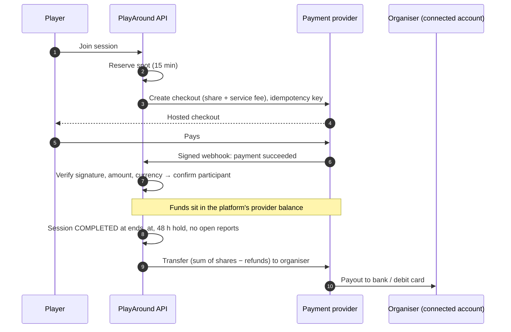
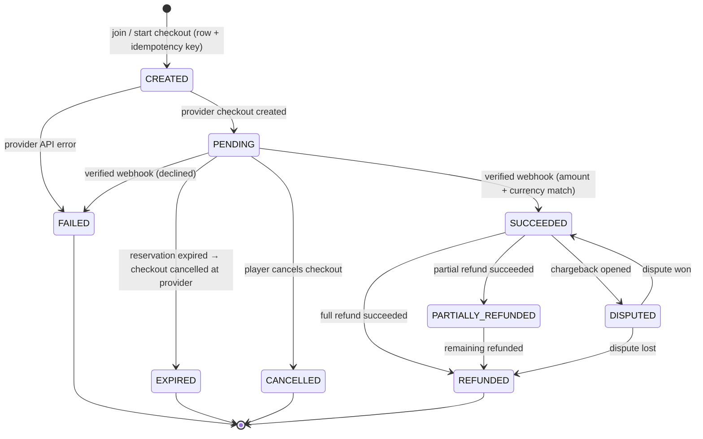
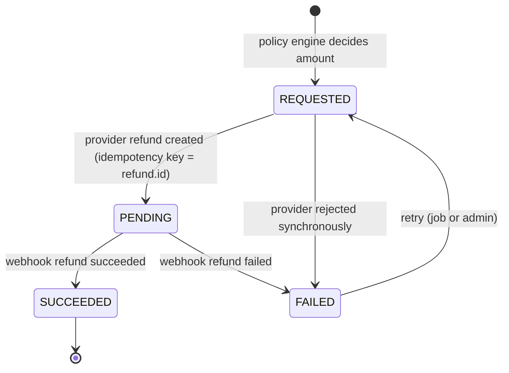

# Future: Online Payments (Stripe preferred, Tap fallback)

> 🔮 **FUTURE — NOT PART OF THE MVP.** Nothing in this document is to be implemented during the MVP phases.
> The MVP uses offline payments only: players pay organisers directly, and PlayAround never collects, holds or transfers money (DEC-012). Stripe, Connect, online checkout and payouts are excluded (DEC-017, DEC-021). Platform revenue is deferred (DEC-018).
> Stripe is the preferred future provider and Tap the possible fallback, **subject to provider approval and UAE legal advice** (DEC-017, launch item L-06). No provider or legal approval has been obtained.
> **Gate:** the settlement model, fees, refund policy and provider must be approved, and confirmed in writing by the provider and a UAE legal advisor, **before any online-payment code is written**. This is a post-MVP phase in the [roadmap](../roadmap.md).

Sections 1–7 are the online-payment design prepared during Phase 1. They're kept as the starting point for that future phase. Where they conflict with the current MVP rules (a 15-minute reservation, `ceil` rounding, service fees, `HELD` / `PENDING_PAYMENT` states), **the MVP rules win**. Those parts are marked "to revisit". The matching schema and API drafts are archived: [database](../archive/database-schema-v2-online-payments.md), [API](../archive/api-contracts-v2-online-payments.md).

## 0. How online payments would build on the MVP

The MVP schema was designed so online payments can be added beside offline records rather than replacing them.

| MVP element | Future evolution |
| --- | --- |
| `payments` (one record per paying participation, offline statuses) | Gains `channel` (`OFFLINE` / `ONLINE`) and provider references; online statuses map onto the same row or a linked `payment_attempts` table |
| `payment_confirmations` (action log) | Online provider events are logged as `SYSTEM` actions alongside manual ones |
| `payment_disputes` (offline disagreements) | Card chargebacks get a separate `provider_disputes` table; offline disputes are unchanged |
| Joining confirms participation (DEC-016) | Paid sessions may require checkout before `CONFIRMED`. This would need a new product decision and a reservation mechanism (removed from the MVP by DEC-034). |
| Largest-remainder split (DEC-019) | Kept; online checkout charges the slot's share |
| No wallet, no payouts (DEC-021) | `payout_accounts`, `payouts`, `payment_transactions`, `payment_webhook_events` and `refunds` tables (see archived schema) |
| `contracts/rules/split.ts` | Unchanged |
| `offline-payments` module | A new `online-payments` module with the provider interface below |

New future decisions needed: merchant-of-record model, fees (DEC-018), refund policy, organiser KYC, venue settlement, checkout-before-join, and legal approval (L-06).

## 1. Money flow and settlement model

### Parties

| Party | Role |
| --- | --- |
| **Player** | Pays their share + service fee by card / Apple Pay / Google Pay |
| **Organiser** | Has paid (EXISTING_BOOKING) or will pay (LOOKING_FOR_PLAYERS) the venue directly. Receives the players' shares as a payout. |
| **PlayAround (platform)** | Collects payments through the provider, keeps the service fee, pays out the organiser after the game |
| **Venue** | Not a party in the MVP. The organiser settles with the venue off-platform. |
| **Payment provider** | Processes cards, holds funds in the platform's provider balance, KYCs organisers, executes payouts |

### Candidate model (future, not approved): platform-collected charges with delayed organiser payouts

Note: in the MVP, venues **are** involved through PlayAround's venue coordination (DEC-029), but venue payment is still made directly by the organiser (DEC-014). The "Venue: not a party" row below reflects only the payment flow.



Why this model:
- **Refunds are simple.** Until the payout, all money is in the platform balance, so a refund never has to claw funds back from an organiser.
- **Fraud protection.** An organiser who invents a booking never receives money if the game is reported as not happening during the hold window.
- **Matches what UAE platforms can do on Stripe:** "separate charges and transfers" is supported for UAE platforms; `on_behalf_of` is not (see §3).
- **Venue settlement can be added later without changing the session module.** A venue becomes another payout account owner (`payout_accounts.owner_type = VENUE`), and the transfer goes to the venue instead of the organiser.

Consequences to accept:
- PlayAround is the **merchant of record**. Card statements show PlayAround, and PlayAround handles disputes and chargebacks.
- Every organiser of a paid session must complete provider KYC (ID, bank or debit card) before publishing.
- The organiser carries the risk of unfilled spots: if 2 of 3 open spots fill, they receive 2 shares.

### Pricing (proposal, needs decision — to revisit: platform revenue is deferred by DEC-018, and shares now use largest-remainder splitting per DEC-019 instead of `ceil`)

| Line | Example (AED 120 court, 4 players, host plays) |
| --- | --- |
| Share per player | `ceil(12000 / 4)` = AED 30.00 |
| Player service fee | e.g. AED 2.00 flat **or** 5%, configurable |
| Player pays | AED 32.00 |
| Organiser receives (3 players) | AED 90.00 (organiser's own share was paid to the venue directly) |
| Platform keeps | AED 6.00 − provider fees |

VAT (5% in the UAE) applies to the platform's service fee if PlayAround is VAT-registered. This needs accounting advice.

## 2. Payment lifecycle



A FAILED payment does not release the spot by itself. The player can retry (a new `payments` row with a new idempotency key) until `reserved_until`.

### Refund lifecycle



Failed refunds raise an admin alert and are retried with backoff (max 5), then escalated to manual handling in the finance view.

## 3. Provider evaluation (UAE)

Based on public provider documentation, checked 8 Nov 2026. This must be **confirmed in writing** with the provider's sales/compliance team.

| | Stripe Connect | Tap Payments Marketplace | Checkout.com Platforms |
| --- | --- | --- | --- |
| UAE platform supported | Yes, but **not self-serve**: UAE platforms must contact Stripe to enable Express/Custom accounts | Yes (GCC-native) | Yes |
| Charge types for UAE | Destination charges, **separate charges & transfers**. `on_behalf_of` **not supported** (platform is the settlement merchant) | Charge with `destinations` split; remainder stays with marketplace | Payments for sub-entities, split to platform |
| Organiser onboarding / KYC | Express (Stripe-hosted onboarding); connected accounts must be **UAE-based** | Retailer accounts; payouts enabled only after Tap's KYC review | Sub-entities can be sole traders or companies |
| Individuals (non-business organisers) as payees | **To verify** | **To verify** (docs show business entities) | Sole traders supported; individuals to verify |
| Payout to organisers | Bank payouts; Instant Payouts to UAE debit cards (min AED 2) | To Tap wallet → bank on Tap's payout cycle | UAE **card** payouts supported; bank payouts listed for US/UK/EEA only |
| Delayed / on-demand transfer | Yes (transfer whenever we decide) | "Instant or on request" via API | On demand or scheduled |
| Refunds API + webhooks | Yes | Yes (full/partial; refund webhook) | Yes |
| Webhook signing | HMAC signature header | `hashstring` header (HMAC) | HMAC signature |
| Apple Pay / Google Pay | Yes | Yes | Yes |
| Developer experience / SDKs | Excellent; hosted Checkout + RN SDK | Good; hosted + SDKs | Good, enterprise-oriented |
| Indicative Connect fees | Stripe-handled pricing: no per-account fee; platform-handled: AED 7.50 per active account/month + 0.25% + AED 5.50 per payout | Negotiated | Negotiated, volume minimums likely |

**Recommendation:** start talks with **Stripe (primary)** and **Tap (fallback)** in parallel.
- Stripe fits the delayed-transfer model exactly and has the best tooling and test mode. The main risks are the manual Connect enablement for UAE and whether individual organisers can be onboarded.
- Tap is the GCC specialist, and local cards and payment methods may perform better. Confirm that individuals can be retailers and that transfers can be delayed until after the game.

Questions to put to each provider:
1. Can a UAE-registered platform onboard **individual** UAE residents (not businesses) as payees?
2. Can we hold funds in the platform balance and transfer them **2–7 days after charge** (per session)?
3. Can the service fee be retained by the platform with the remainder transferred later?
4. Max hold period for funds before transfer; any reserve requirements?
5. Chargeback liability allocation and fees.
6. Can a pending checkout be expired/cancelled via API (if a checkout reservation is reintroduced; removed from the MVP by DEC-034)?
7. Settlement currency AED, settlement cycle, refund cost.

Provider facts above are from public documentation only. Nothing here constitutes provider or legal approval (L-06).

**Regulatory note:** collecting money from players and paying it to individuals may be a regulated payment activity under the CBUAE *Retail Payment Services and Card Schemes Regulation*. Using a licensed provider that holds the funds (rather than our own bank account) is the standard mitigation. **Get UAE legal advice before launch.** Also confirm the trade licence activity covers an online marketplace / sports booking platform.

**App stores:** these are payments for real-world services consumed outside the app, so Apple In-App Purchase is **not** required (App Store guideline 3.1.3(e)). The same applies on Google Play. Standard card checkout is allowed.

## 4. Refund policy (proposed, to revisit; in the MVP, refunds are offline and recorded only, per DEC-022)

| Situation | Player refund | Service fee | Organiser payout |
| --- | --- | --- | --- |
| Organiser cancels, admin cancels, or venue deadline lapses | 100% share | Refunded | None |
| Organiser removes the player | 100% | Refunded | Reduced |
| Session time/venue changed after payment; player leaves within 24 h | 100% | Refunded | Reduced |
| Player leaves ≥ 24 h before start | 100% share | **Kept** | Reduced |
| Player leaves < 24 h before start, spot gets re-filled by a paying player | 100% share | Kept | Unchanged |
| Player leaves < 24 h before start, spot not re-filled | 0% | Kept | Unchanged |
| Player no-show | 0% | Kept | Unchanged |
| Late payment after reservation expired, no spot left | 100% | Refunded | — |
| Reported "game didn't happen", upheld by admin | 100% | Refunded | Withheld |
| Duplicate charge detected (should never happen) | 100% | Refunded | — |

The policy is implemented as a pure function `computeRefund(context) → { shareMinor, feeMinor, reason }` in `packages/contracts/rules` and **shown to the player before they confirm leaving**. The API recomputes it.

## 5. Module design

```
apps/api/src/modules/payments/
├── payments.service.ts          # domain API used by other modules
├── payments.repository.ts
├── checkout.service.ts          # create/resume checkout
├── webhooks.controller.ts       # raw-body route, signature check, store event
├── webhook-processor.ts         # idempotent processing of stored events
├── refunds.service.ts           # policy → refund rows → provider
├── payouts.service.ts           # payout accounts, transfers
├── reconciliation.job.ts
├── reservation-sweeper.job.ts
└── providers/
    ├── payment-provider.ts      # interface
    ├── stripe.provider.ts
    ├── tap.provider.ts          # added only if chosen
    └── fake.provider.ts         # dev + tests: deterministic, simulates webhooks
```

### Provider interface

```ts
interface PaymentProvider {
  readonly code: 'STRIPE' | 'TAP' | 'FAKE';

  createCheckout(input: {
    paymentId: string;              // our id, also the idempotency key
    amountMinor: number;
    currency: string;
    description: string;
    customer: { id: string; email: string };
    expiresAt: Date;
    returnUrl: string;              // our "confirming payment…" screen, never trusted
    metadata: Record<string, string>;
  }): Promise<{ providerCheckoutId: string; redirectUrl: string }>;

  cancelCheckout(providerCheckoutId: string): Promise<void>;
  getPayment(providerPaymentId: string): Promise<NormalizedPayment>;
  refund(input: { refundId: string; providerPaymentId: string; amountMinor: number }):
    Promise<{ providerRefundId: string; status: 'PENDING' | 'SUCCEEDED' | 'FAILED' }>;

  verifyAndParseWebhook(rawBody: Buffer, headers: Record<string, string>): NormalizedEvent; // throws on bad signature

  createPayoutAccount(user: PayoutOwner): Promise<{ providerAccountId: string }>;
  createOnboardingLink(providerAccountId: string, returnUrl: string): Promise<string>;
  getPayoutAccount(providerAccountId: string): Promise<NormalizedPayoutAccount>;
  transfer(input: { payoutId: string; providerAccountId: string; amountMinor: number; currency: string }):
    Promise<{ providerTransferId: string }>;
}
```

`NormalizedEvent` types: `payment.succeeded | payment.failed | payment.expired | refund.succeeded | refund.failed | dispute.opened | dispute.closed | payout_account.updated | transfer.paid | transfer.failed`. The sessions and participants modules only ever see these normalised domain events. A provider swap touches `providers/` and config only.

### Checkout UX
**Provider-hosted checkout** opened in an in-app browser (`expo-web-browser`) on mobile, and by redirect on web. This keeps the integration identical across platforms and providers, puts us in PCI SAQ-A scope, and gives Apple Pay / Google Pay for free. A native payment sheet (e.g. Stripe PaymentSheet) can be added later as an optional adapter capability.

After returning, the client shows **"Confirming your payment…"** and waits for `payment:updated` over Socket.IO, falling back to polling `GET /payments/:id` every 2 s for up to 60 s. The client never marks a participant as confirmed itself.

## 6. Safeguards

| Risk | Safeguard |
| --- | --- |
| Double-tap / retried request creates two payments | `Idempotency-Key` header stored in `idempotency_keys` (same key → same response) |
| Two live payments for one participant | `payments.active_lock` = `participant_id` while CREATED/PENDING/SUCCEEDED/PARTIALLY_REFUNDED/DISPUTED, NULL otherwise. **UNIQUE** (MySQL allows many NULLs). |
| Duplicate charge at the provider | Provider idempotency key = our `payments.id`; refunds use `refunds.id` |
| Webhook replay / duplicates | `payment_webhook_events (provider, provider_event_id)` UNIQUE; already-processed events return 200 immediately |
| Forged webhook | Signature verified on the **raw body** before parsing; failures logged and return 400 |
| Tampered amount | Webhook amount + currency compared with the `payments` row; mismatch → payment not confirmed, `failure_code = AMOUNT_MISMATCH`, admin alert, auto-refund |
| Trusting the client | Client return URL only triggers a status read; confirmation happens only in the webhook processor (or the reconciliation job, which reads from the provider API) |
| Missed webhooks | Reconciliation job every 5 min: PENDING payments older than 10 min are fetched from the provider and processed through the same code path |
| Overbooking via late payment | Session row lock + capacity check in the webhook processor; refund if full |
| Out-of-order events | State machine ignores transitions that move backwards; events carry provider timestamps |
| Ledger drift | Every money movement is a `payment_transactions` row; daily report compares sums with provider balance transactions |
| Organiser fraud | KYC, 48 h payout hold, reports block payout, admin can hold payouts |

### Webhook processing

```
POST /api/v1/webhooks/payments/:provider   (express.raw, no auth, own rate limit)
  1. provider.verifyAndParseWebhook(rawBody, headers)      → 400 if invalid
  2. INSERT payment_webhook_events … ON DUPLICATE KEY → if PROCESSED return 200
  3. respond 200 quickly
  4. process (in-process queue now; BullMQ later):
       BEGIN
         SELECT payment FOR UPDATE
         SELECT session FOR UPDATE (when capacity is affected)
         apply transition, write payment_transactions, update participant + counters
         insert notifications
         mark event PROCESSED
       COMMIT
       emit socket events + push
     on error → event FAILED, attempts++, retried by job with backoff
```

## 7. Payouts

- `payout_accounts`: one per organiser (later per venue). Status mirrored from provider webhooks (`charges/payouts enabled`, requirements due).
- Payout job: for sessions `COMPLETED` where `ends_at + hold` has passed, with no open reports or disputes and payout account `ACTIVE`, compute `Σ succeeded shares − Σ share refunds` and create a `payouts` row + provider transfer (idempotency key = `payouts.id`).
- Finance admins can **hold**, **release** or **cancel** a payout, with a mandatory reason that is written to the audit log.
