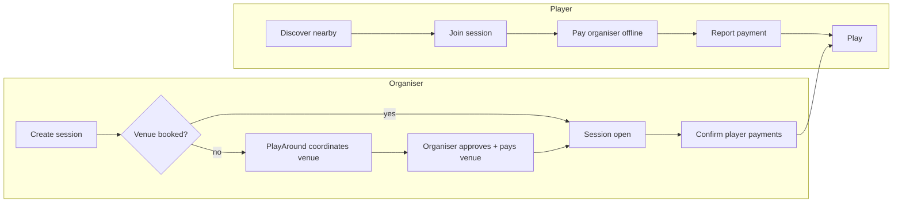

# Product Overview

## What PlayAround is

A UAE-first platform for finding people to play sport with nearby. Players discover sessions around their current or chosen location and join them. Organisers publish sessions, either for a venue they've already booked or as a request that PlayAround helps turn into a booked game.

Launch sports: **badminton, football, cricket** (DEC-002). Language English, currency AED, timezone Asia/Dubai (DEC-001).

## Who uses it

| User | Goal |
| --- | --- |
| **Player** | Find a game nearby at a suitable time and price, join, show up, pay their share to the organiser |
| **Organiser** | Fill a booked court or pitch, or get a game arranged; see who has joined and who has paid |
| **PlayAround staff** | Coordinate venue arrangements, support users, moderate, keep the catalogue (sports, venues) accurate |

Any registered user can be both a player and an organiser. Organising requires a verified phone number (DEC-036). See [roles and permissions](roles-and-permissions.md).

## Core loops

1. **Discover and join.** Location-based discovery (GPS or manual), map and list views, filters. Joining confirms a spot immediately when capacity is available. It does not mean the player has paid (DEC-016).
2. **Create with an existing booking** (`EXISTING_BOOKING`). The organiser enters the venue, time, capacity and total cost. The session is joinable immediately.
3. **Create while looking for players** (`LOOKING_FOR_PLAYERS`). The organiser gives a preferred area, time, capacity and estimated cost. PlayAround coordinates venue options and the organiser approves one and pays the venue. The session becomes joinable only once the venue is confirmed (DEC-028, DEC-029).
4. **Settle offline.** Each player owes a share of the total cost, split with largest-remainder allocation. Players pay the organiser directly and may report "I've paid". Only the organiser (or an authorised admin) confirms receipt (DEC-012, DEC-013). PlayAround never touches the money.

## What makes it work

- Location first: sessions sorted by distance with an auto-expanding radius ([location discovery](../architecture/location-discovery.md)).
- Trust without payments: verified organiser phones, payment records, disputes, reviews and reports.
- Clear session states: capacity, optional minimum players, venue confirmation, completion rules ([session lifecycle](../workflows/session-lifecycle.md)).
- Premium, Apple-inspired glass UI on mobile and web, plus a separate admin app.

## Where to read next

- [MVP scope](mvp-scope.md): what is and isn't in the first release.
- [Approved business rules](business-decisions.md): rules and default values for implementation.
- [Decision log](../decisions/decision-log.md): every decision with its status.
