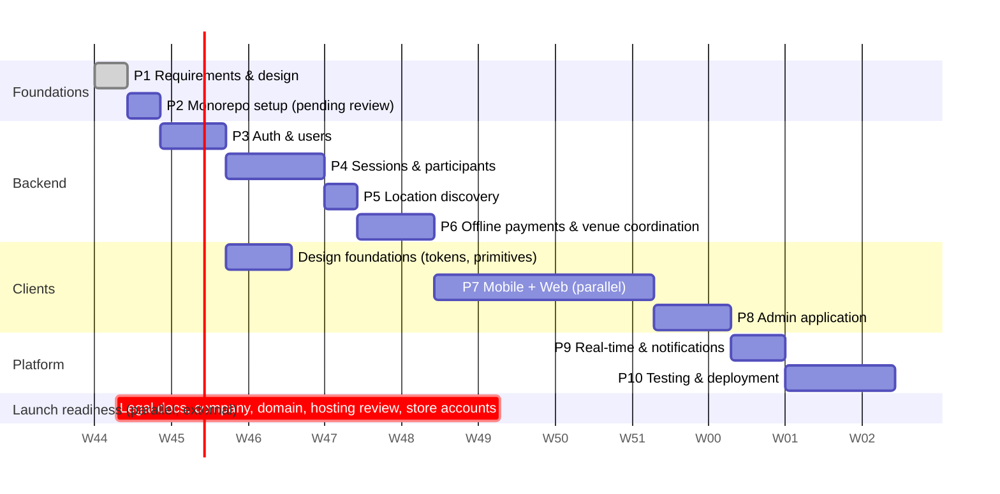

# Development Roadmap (v3: offline-payment MVP)

The MVP uses **offline payments** (DEC-012). No payment provider, checkout, webhook, payout or Stripe work appears in any MVP phase. Online payments are a post-MVP phase ([future](future/online-payments-stripe.md)).

Each phase ends with a **verification gate** and needs your approval before the next phase starts. Estimates assume one developer with AI assistance. No launch date is set (L-04), so the chart shows relative durations only.

**Parallel tracks:**
- **Design foundations** (tokens, glass primitives, component previews) start once the Phase 3 contracts are stable. They have no API dependency.
- **Launch readiness:** terms, privacy policy and organiser agreement (L-05, DEC-038), company and launch details (L-01–L-04), domain verification (L-07), hosting review (L-08) and app store accounts (L-09). None of these block Phase 2.

---

## Phase 1: Requirements, Architecture and Database Design *(complete)*
- [x] Product overview, approved business decisions, MVP scope, roles and permissions
- [x] Architecture and technology stack, location discovery, admin application
- [x] Offline-payment MVP database schema, API specification
- [x] Workflows: authentication, session lifecycle, venue management, offline payments
- [x] Decision log (approved, recommended, open questions, launch items, superseded)
- [x] Future online payments (Stripe preferred, Tap fallback) separated from the MVP
- [ ] **Your review** of the reconciled docs

**Gate:** docs approved. Open questions O-01 to O-16 don't block Phase 2. Each one names the phase that needs it ([decision log §3](decisions/decision-log.md)).

## Phase 2: Monorepo Setup (~3 days) *(implemented, awaiting approval)*
- [x] **Node.js runtime evaluation (DEC-008):** Node.js 26.13.0 pinned in `.nvmrc` and `engines`. Prisma 7 still warns that Node 26 is unofficial; generate/validate/runtime succeeded. See the decision log.
- [x] pnpm workspace, Turborepo (`dev`, `build`, `lint`, `typecheck`, `test`), CI workflow (`.github/workflows/ci.yml`)
- [ ] Git init deferred (explicitly skipped)
- [x] `packages/config`, `packages/contracts` (enums, error codes, money in fils, `rules/split.ts`), `packages/design-tokens`, `packages/api-client` skeletons
- [x] `apps/api`: app factory, env validation, logger, errors, health, OpenAPI shell, event bus, job runner skeleton
- [x] Prisma schema from [database/schema.md](database/schema.md): `prisma validate`, first migration SQL with CHECK constraints, seed framework (UAE venues, three sports)
- [x] Docker Compose: MySQL 8.4 + Mailpit via Colima (DEC-007)
- [x] `prisma migrate` and seed against local Docker MySQL (3 sports, 10 venues, 10 settings)
- [x] `apps/web`, `apps/admin` (Next.js + Tailwind + shadcn/ui) and `apps/mobile` (Expo + Expo Router + NativeWind) booting with placeholder screens
- [x] No payment-provider SDKs, keys or environment variables

**Gate:** `pnpm dev` runs API, web, admin and mobile — **passed**. `/api/v1/health/ready` reports `database: up` after migrate/seed — **passed**. CI workflow is in the repo; it has not been executed on GitHub because Git is not initialised. Node runtime decision recorded.

## Phase 3: Backend Authentication and User Management (~6 days) *(implemented, awaiting approval)*
- [x] Register, login, refresh rotation with reuse detection, logout and logout-all
- [x] Email verification, password reset (Mailpit locally)
- [x] Google Sign-In and Sign in with Apple (DEC-035), with identity linking (JWKS in production; tests inject verifiers)
- [x] Phone verification by SMS OTP (O-13 console stub); verified phone required for organiser publishing later (DEC-036)
- [x] Profile, favourite sports, devices, account deletion rules
- [x] Roles, `requireRole`, staff seed users, mandatory staff TOTP enrolment and recovery (DEC-037)
- [x] Rate limiting, helmet, CORS, idempotency middleware (attach `requireIdempotency` on session/admin mutations from Phase 4)

**Gate:** auth integration tests (rotation, reuse, expiry, suspension, social linking, phone OTP limits, TOTP lockout) — **passed**. Swagger lists the auth, users and admin-auth paths.

## Phase 4: Backend Sessions and Participants (~9 days) *(implemented, awaiting approval)*
- [x] Sports (with sport-level player limits) and venues (search, nearby, create and dedupe, staff-only fields)
- [x] Create `EXISTING_BOOKING` and `LOOKING_FOR_PLAYERS`, including:
  - 3-hour lead time (DEC-024);
  - organiser limit of 10 (DEC-025);
  - capacity and optional minimum players (DEC-026);
  - organiser participation (DEC-027);
  - AED 10 minimum share (DEC-020).
- [x] Largest-remainder split with share slots (DEC-019)
- [x] Join (confirms if capacity is available; LFP only after venue confirmed), leave, remove, re-join, all with row locks and counters
- [x] Interest for pending LFP sessions (O-01)
- [x] Editing rules; price and capacity changes with notifications and the > 20% consent flow (DEC-031)
- [x] Minimum-player decision and auto-cancel job (DEC-032)
- [x] Completion and expiry rules (DEC-033), attendance marking (O-07)
- [x] Cancel, session events timeline, My Activities
- [x] Notifications **persisted** for all events (delivery in Phase 9); reviews; reports

**Gate:**
- Concurrency suite green: 50-way join, leave and join races, unique share slots.
- Lifecycle tests cover every transition in the [session lifecycle](workflows/session-lifecycle.md).
- Split tests: AED 100 / 3 = 33.34 + 33.33 + 33.33.

## Phase 5: Backend Location Discovery (~3 days) *(implemented, awaiting approval)*
- [x] Nearby query (bounding box + `ST_Distance_Sphere`), AREA distance adjustment
- [x] Filters (including `joinableOnly`), sorts, bands, auto-expansion, cursor pagination, recommendations
- [x] Load-test seed (100k sessions) and `EXPLAIN` review

**Gate:** distance, band and filter integration tests; pending LFP sessions shown as not joinable; p95 < 300 ms locally on 100k sessions.

## Phase 6: Backend Offline Payments and Venue Coordination (~7 days) *(implemented, awaiting approval)*
- [x] Payment records created and updated with participation and price changes (DEC-015, DEC-016, DEC-023)
- [x] Player report and retract; organiser confirm, reject, waive and record refund; partial amounts; action log (DEC-013, DEC-022)
- [x] Payment disputes: open, withdraw, organiser resolution, staff resolution, one open dispute per payment
- [x] Payment reminders; organiser payment overview per session
- [x] Venue arrangement queue and options; organiser approve and reject; booking recording for both types; venue payment status (informational) (DEC-014, DEC-029, DEC-030)
- [x] Venue deadline job (O-02)
- [x] Admin endpoints for arrangements, payment corrections and disputes (UI in Phase 8)

**Gate:**
- Every payment transition in the [offline payment workflow](workflows/offline-payments.md) is tested, including the who-may-change matrix (IDOR tests).
- Concurrent payment-action test is green.
- LFP flow end to end via API: create, request, propose, approve, record, joinable.
- No provider code or tables exist.

## Phase 7: Mobile and Web Applications, in Parallel (~20 days) *(implemented, awaiting approval)*
Shared first: `api-client` hooks, query keys, socket client stub, form schemas.

| Area | Mobile (Expo) | Web (Next.js) |
| --- | --- | --- |
| Design system | Glass primitives, iOS blur with Android fallback, light and dark | Tailwind preset and shadcn restyle, light and dark |
| Auth | Splash, onboarding, login, register, verify email, Google and Apple sign-in, phone verification, reset | Landing (SSR), auth pages, cookie refresh |
| Discover | Location flow (GPS or manual), sport chips, filters sheet, sections by band, map/list toggle, "Venue being arranged" cards | Split view: filters, list, sticky map, hover-linking |
| Session details | Type-aware UI, live availability, join, interest and leave, share split, "Pay the organiser directly" notice, share link | Same, plus public `/s/[id]` OG page |
| Create session | Type choice, sport, venue or area, time, capacity and minimum, cost with live split preview, review | Multi-step page |
| Organiser tools | Venue options review and approve (LFP), record booking, payment overview (confirm, waive, refund), minimum-player decision, attendance, price-change preview | Same |
| Player payments | "I've paid" report, payment status, disputes, price-consent accept/reject | Same |
| Activities | Organised, joined and interested; upcoming, completed and cancelled; payment-status badges | Same |
| Notifications, Profile | ✔ | ✔ |

**Gate:**
- Feature parity checklist.
- Core loops pass on iOS, Android and web against staging:
  - create both session types, then discover, join, report payment, organiser confirms;
  - price change with consent;
  - leave and offline refund recorded;
  - cancel.
- Loading, empty and error states everywhere.
- Lighthouse ≥ 90 on landing and discover.

## Phase 8: Admin Application (~7 days)
- [x] Staff login with mandatory TOTP, role-aware navigation (`SUPPORT`, `OPERATIONS`, `SUPER_ADMIN`; O-12)
- [x] Overview KPIs; users; sessions with timeline; venues (verify, merge, staff contact fields); sports CRUD
- [x] **Venue arrangement queue** with option editor and booking on the organiser's behalf
- [x] **Payment records and disputes**: confirm, waive, refund and correct with a reason
- [x] Reports moderation, review hiding, platform settings, audit log viewer

**Gate:** RBAC matrix tests (each role sees and does only what it should); every mutation audited. **Implemented, awaiting approval.**

## Phase 9: Real-time Updates and Notifications (~5 days)
- [x] Socket.IO gateway, auth handshake, rooms, subscription limits, admin feed
- [x] Event bus emits after commit; `version`-guarded cache patching in `api-client`
- [x] Expo push delivery and receipts, preferences
- [x] Reminders: session (24 h, 1 h), payment, price consent, minimum-player decision, venue deadline

**Gate:** two devices see join, leave, full, venue-confirmed and payment-status events within 1 s; an offline user receives persisted notifications on next open. **Approved (proceeded to Phase 10).**

## Phase 10: Testing and Deployment (~10 days) *(implemented locally, launch blocked)*
- [x] Coverage ≥ 80% on `*.service.ts`; Playwright (web, admin) and Maestro (mobile) E2E for core loops
- [x] k6 load: discovery and join bursts; soak test of the scheduled jobs
- [x] Security: OWASP API checklist, auth and IDOR tests on session/payment `:id` routes, dependency audit, secret scan
- [ ] Infra on the reviewed host (L-08): production API, managed MySQL with point-in-time recovery, web and admin hosting, verified domain (L-07), Sentry, uptime and alerting — **blocked**
- [ ] Terms, privacy policy and organiser agreement published (L-05; required before public launch per DEC-038) — routes exist, copy **not published**
- [ ] EAS builds, TestFlight and Play internal testing, store listings, privacy labels, location disclosures (L-09) — **blocked**
- [ ] Coordinated launch: mobile store approval, web and admin go live together (DEC-003) — **blocked**

**Gate:** production smoke test across all three clients; store approvals received; legal documents published; rollback plan documented. **Local tooling is in; production gate waits on L-05, L-07, L-08, L-09.** See [phase-10-launch.md](product/phase-10-launch.md).

## Post-MVP

| Item | Notes |
| --- | --- |
| **Online payments: Stripe preferred, Tap fallback** | Gated on provider approval, UAE legal advice and new product decisions (DEC-017, L-06). Design: [future/online-payments-stripe.md](future/online-payments-stripe.md). |
| Platform revenue | Deferred (DEC-018) |
| Group / session chat | `conversation:{id}` channel and Redis adapter (DEC-010) |
| Backlog | Waitlists, Arabic/RTL, recurring sessions, reliability scores, venue partner integrations |

## Key risks

| Risk | Impact | Mitigation |
| --- | --- | --- |
| Players don't pay organisers offline | Organiser frustration | Clear "pay the organiser" messaging, report/confirm flow, reminders, disputes, organiser payment overview |
| Venue coordination doesn't scale with manual staff work | LFP sessions lapse | Queue sorted by deadline, option `valid_until`, service level (O-16), catalogue contact data, metrics on lapse rate |
| 3-hour lead time vs venue deadline (O-02) | LFP sessions created close to start have very little time for coordination | Decide O-02 before Phase 4; placeholder rule in the docs |
| Price changes after joining | Player distrust | > 20% consent (DEC-031), free leave on rejection, timeline visible to staff |
| Simultaneous three-client launch | Schedule pressure | Shared `api-client` and contracts; parallel tracks; feature-parity checklist |
| Node.js runtime compatibility | Tooling breakage | Pinned to 26.13.0 after Phase 2 evaluation (DEC-008). Watch Prisma 7's unofficial Node 26 support. |
| Android blur performance | Janky UI | Planned fallback |
| Unresolved launch items (company, city, legal, domain, hosting) | Launch delay | Tracked as L-01 to L-09; none block development |
