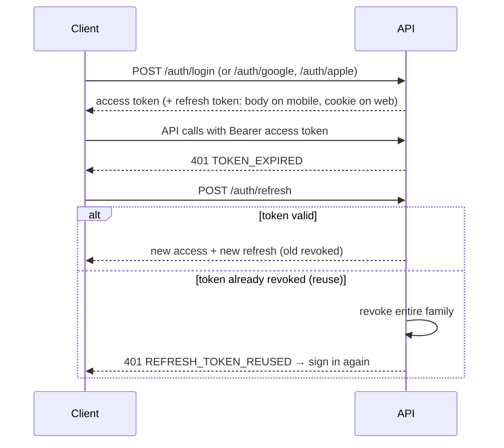
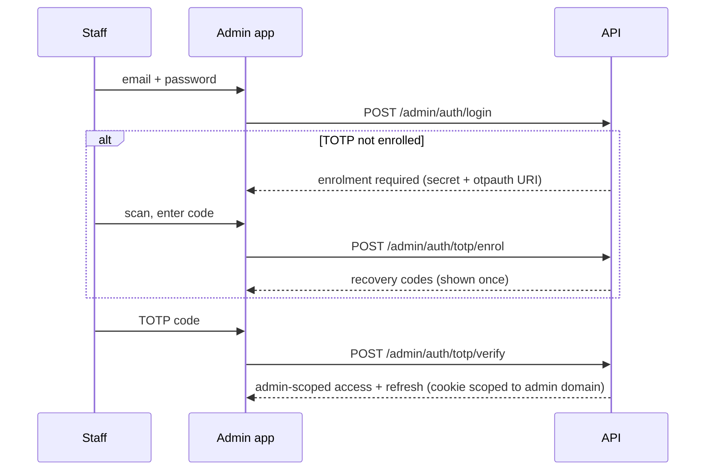

# Authentication Workflow

## 1. Methods

| Method | Clients | Server verification | Decision |
| --- | --- | --- | --- |
| Email + password | Mobile, web | Password hash (argon2id) | DEC-035 |
| Google Sign-In | Mobile (native Google Sign-In), web (Google Identity Services) | Verify Google ID token (issuer, audience = our client IDs, expiry, signature) | DEC-035 |
| Sign in with Apple | Mobile (`expo-apple-authentication`), web (Sign in with Apple JS) | Verify Apple identity token against Apple's public keys; handle private-relay emails; name only arrives on first sign-in | DEC-035 |
| Staff password + TOTP | Admin only | Password + TOTP code | DEC-037 |

External identities are stored in `auth_identities (provider, provider_user_id)`, unique per pair. A user may have several.

**Account linking (recommended):** if a Google/Apple sign-in arrives with a provider-verified email that matches an existing account whose email is also verified, link automatically. Otherwise the user must sign in with the existing method first and link from settings. Never link to an unverified account.

## 2. Verification requirements

| Check | Required for | Decision |
| --- | --- | --- |
| Email verified | Joining and creating sessions (Google/Apple emails count as verified) | Recommended (carried from Phase 1) |
| Phone verified | **Publishing sessions** (organisers) | DEC-036 |
| Phone | Optional for players | DEC-036 |
| TOTP enrolled | Any staff action | DEC-037 |

### Phone verification
1. `POST /users/me/phone` with an E.164 number → 6-digit code by SMS (provider pending O-13). The code is hashed, valid 10 min, max 5 attempts, rate-limited to 3 sends/hour.
2. `POST /users/me/phone/verify` with the code → `phone_verified_at` set.
3. Changing the number clears verification. An organiser with upcoming sessions must re-verify before publishing new ones.

## 3. Tokens (ARC-003)

| Token | Lifetime | Storage |
| --- | --- | --- |
| Access JWT | 15 min (admin: 10 min, `scope: admin`) | Memory only |
| Refresh token (opaque, rotating) | 30 days (admin: 12 h) | Web/admin: httpOnly, Secure, SameSite=Lax cookie on the API domain. Mobile: `expo-secure-store`. |

Refresh tokens are stored hashed with a `family_id`. Each refresh revokes the old token and issues a new one in the same family. **Reusing a revoked token revokes the whole family** (theft detection) and forces sign-in.

The shared `api-client` handles refresh once per 401, queueing concurrent requests while the refresh is in flight.

## 4. Email/password flows
- **Register:** email, password (min 10 characters; checked against a common-password list), display name. A verification code is emailed (Mailpit locally).
- **Forgot password:** always returns 202 (no account enumeration). Reset code valid 30 min. A successful reset revokes all refresh tokens.
- **Change email:** requires the current password and verifying the new address.

## 5. Staff (admin application)

- Only users with a staff role can complete admin sign-in. Staff sign in with password + TOTP (social sign-in isn't used for admin; recommended).
- TOTP secrets are encrypted at rest; recovery codes are hashed and single-use.
- Five failed TOTP attempts lock admin sign-in for 15 min and alert super admins.
- A staff member's own role or TOTP can only be reset by another super admin (audited).

## 6. Account lifecycle
- **Suspension** (staff): blocks sign-in and revokes all tokens. Upcoming organised sessions are flagged for staff review.
- **Deletion** (self-service; required by both app stores): blocked while the user organises upcoming sessions or has open payment disputes (recommended). Otherwise: soft delete, PII scrubbed (email replaced with a tombstone, profile cleared, identities removed), participations in upcoming sessions cancelled, history kept anonymised.

## 7. Rate limits

| Endpoint group | Limit |
| --- | --- |
| Login / register / social sign-in | 10 per 15 min per IP and per email |
| Forgot password, resend verification | 3 per hour per account |
| Phone code send | 3 per hour per user and per number |
| Admin login + TOTP | 5 attempts per 15 min per account |
