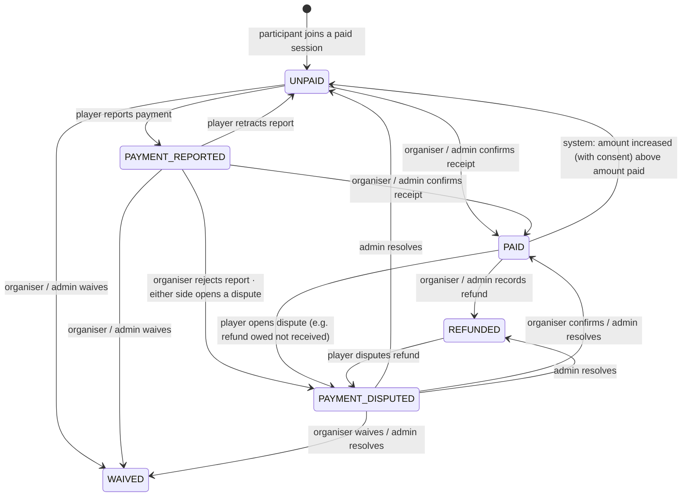
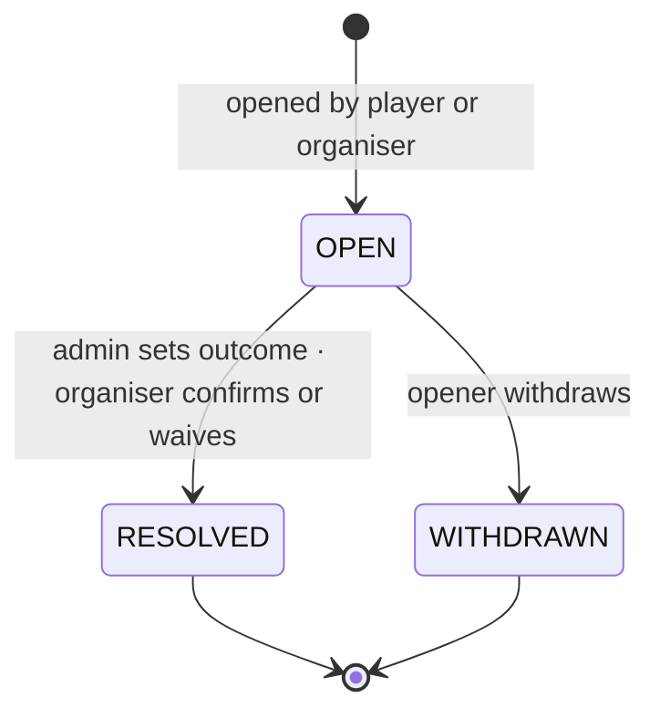

# Offline Payment Workflow

> **PlayAround does not collect, hold or transfer player money in the MVP** (DEC-012). Players pay organisers directly; organisers pay venues directly. PlayAround **records** what the parties report so that both sides, and support, can see who owes what.

UI copy on every payment screen: *"Pay the organiser directly. PlayAround doesn't process payments."*

## 1. What gets recorded

| Record | When | Purpose |
| --- | --- | --- |
| `payments` | One per paying participation (role `PLAYER`, session total > 0), created on join | Amount due/agreed/paid/refunded, current status |
| `payment_confirmations` | Append-only, one per action | Who did what, when, from which status to which, method and reference |
| `payment_disputes` | When either side disagrees | Reason, description, resolution |
| `venue_bookings.venue_payment_status` | Organiser's own venue payment | Informational ([venue management](venue-management.md)) |

No payment record is created for the organiser's own share (they paid the venue) or for free sessions (pending O-09).

## 2. Payment status (DEC-015)

| Status | Meaning |
| --- | --- |
| `UNPAID` | Nothing confirmed. Also used when an accepted price increase leaves a balance; `amount_paid_fils` keeps the partial amount. |
| `PAYMENT_REPORTED` | Player says they've paid; awaiting the organiser |
| `PAID` | Organiser (or authorised admin) confirmed receipt of at least `amount_due_fils` |
| `PAYMENT_DISPUTED` | An open dispute exists; `status_before_dispute` is stored on the dispute |
| `WAIVED` | Organiser chose not to collect |
| `REFUNDED` | Organiser recorded an offline refund (`refunded_amount_fils`, may be partial) |

**Who may change what (DEC-013)**

| Action | Player | Organiser | Authorised admin |
| --- | :-: | :-: | :-: |
| Report payment / retract report | ✅ | | |
| Confirm receipt | | ✅ | ✅ (reason required) |
| Reject a report (opens dispute) | | ✅ | |
| Waive | | ✅ | ✅ |
| Record refund | | ✅ | ✅ |
| Open dispute | ✅ | ✅ | |
| Resolve dispute / correct status | | Organiser can resolve by confirming or waiving | ✅ |

## 3. Amounts

| Field | Meaning |
| --- | --- |
| `amount_due_fils` | Current share for this participant's slot (largest-remainder split) |
| `agreed_amount_fils` | Amount the participant agreed to (at join, or by accepting a price increase) |
| `amount_paid_fils` | Total confirmed as received by the organiser |
| `refunded_amount_fils` | Total recorded as refunded |

- **Confirming receipt** records the amount received (default: outstanding balance). Status becomes `PAID` when `amount_paid_fils ≥ amount_due_fils`.
- **Price decrease** after `PAID`: the status stays `PAID`, and the app shows "refund of difference may be due" (`amount_paid − amount_due`).
- **Accepted price increase** after `PAID`: if `amount_due > amount_paid`, the system moves the status to `UNPAID` with the partial amount retained.
- **Cancelled participation** (leave, removal, session cancelled): an `UNPAID` / `PAYMENT_REPORTED` record becomes **inactive** (nothing owed; shown greyed out). A `PAID` record shows "refund may be due". PlayAround doesn't decide whether a refund is owed (O-11).
- **`NO_SHOW`** doesn't change payment status; whether a no-show still owes is between organiser and player (O-11).

## 4. Disputes

- Reasons: `PAYMENT_NOT_RECEIVED` (organiser), `PAYMENT_NOT_ACKNOWLEDGED` (player), `REFUND_NOT_RECEIVED` (player), `AMOUNT_INCORRECT` (either), `OTHER`.
- At most one open dispute per payment (enforced by a unique `open_lock` column).
- While open, the payment is `PAYMENT_DISPUTED`. On withdrawal it returns to `status_before_dispute`. On resolution it takes the resolved status.
- Disputes appear in the admin **payment disputes** queue. Staff can view evidence notes, contact both parties outside the app, and set the outcome with a mandatory note (audited).
- PlayAround's role is record-keeping and moderation. It can't move money; repeat abuse is handled via reports and suspension.

## 5. Typical flows

### Player pays cash at the venue
1. Player joins → payment `UNPAID`, owes AED 30.
2. At the game, the player pays cash and taps "I've paid" (method `CASH`) → `PAYMENT_REPORTED`; organiser notified.
3. Organiser taps "Confirm received" → `PAID`; player notified.

### Organiser confirms without a report
Organiser receives a bank transfer and marks `PAID` directly (method `BANK_TRANSFER`, reference optional).

### Session cancelled after payment
1. Session cancelled → participation `CANCELLED`; payment stays `PAID` with "refund may be due".
2. Organiser refunds offline and records the refund → `REFUNDED`; player notified.
3. If the player disagrees → dispute `REFUND_NOT_RECEIVED`.

## 6. Payment methods (pending O-10)
Placeholder enum: `CASH`, `BANK_TRANSFER`, `PAYMENT_APP`, `OTHER`, plus a free-text reference (max 80 chars). PlayAround never stores card or bank account numbers. References are validated to block card-number-like strings.

## 7. Visibility and privacy
- Players see only their own payment records. Organisers see all records for their sessions. Admins see all.
- Payment records are never shown publicly, on share pages or in reviews.

## 8. Future online payments
Online checkout, Stripe, Connect and payouts are excluded from the MVP (DEC-017, DEC-021). The future design, including how these offline tables evolve, is in [future/online-payments-stripe.md](../future/online-payments-stripe.md).
