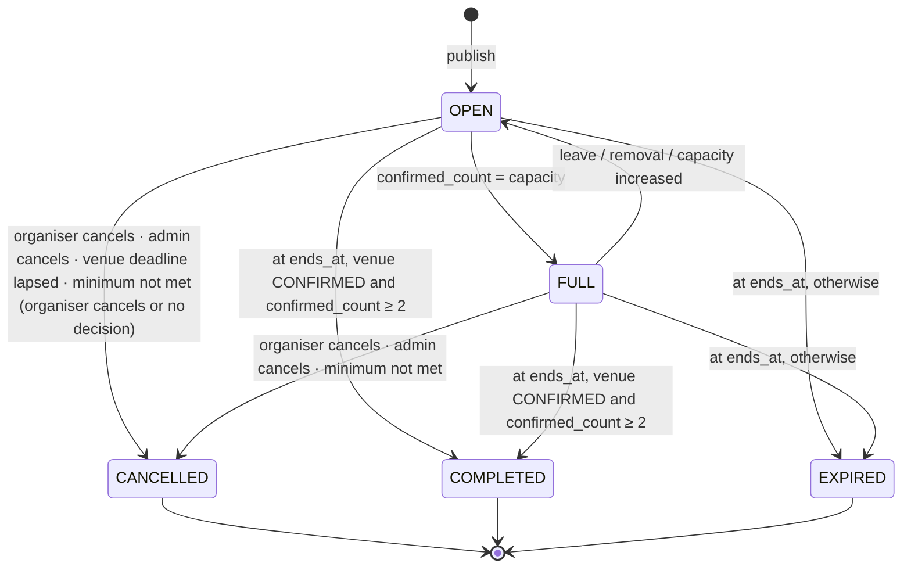
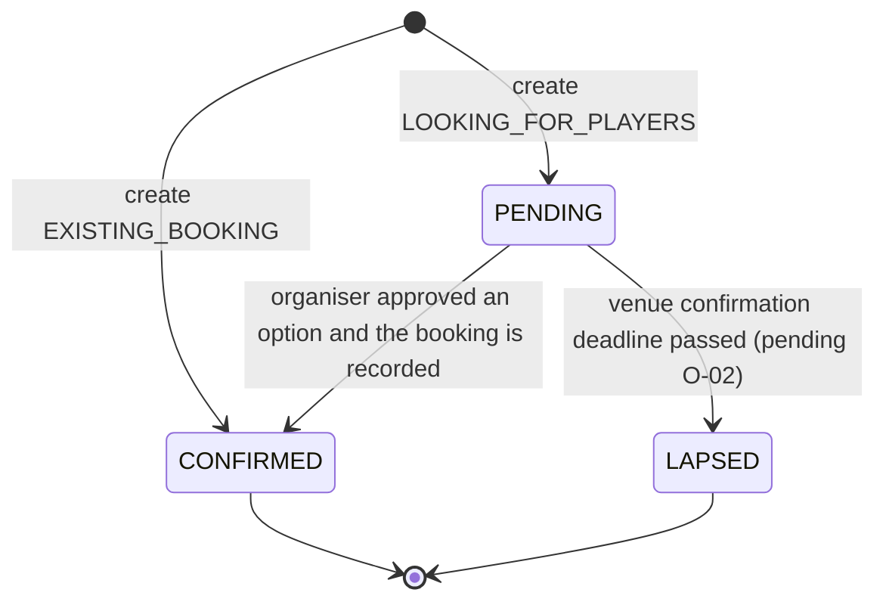
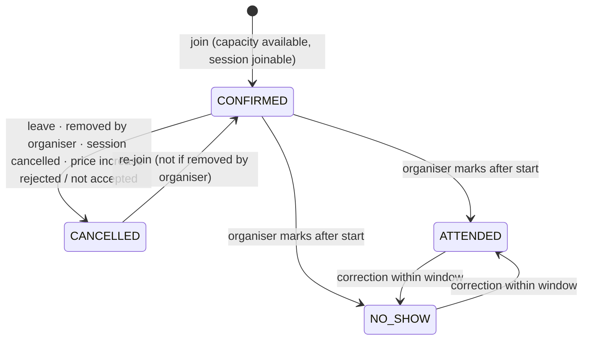
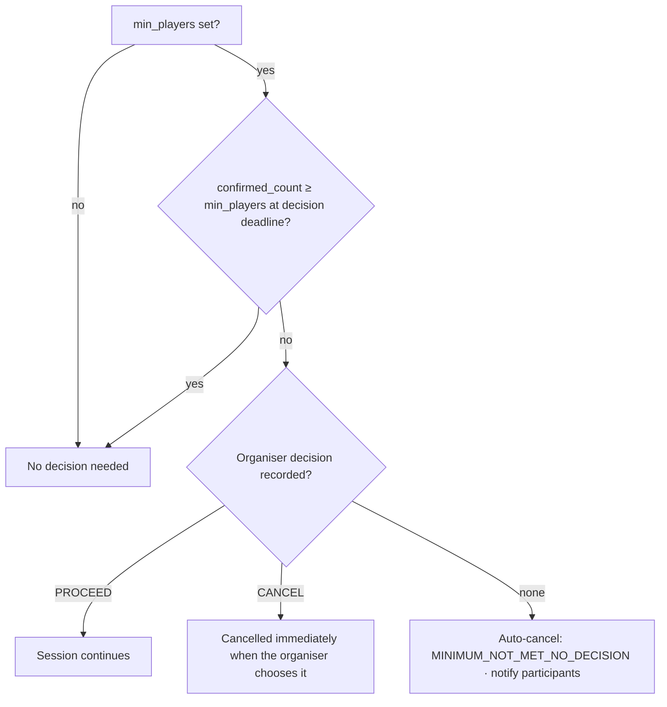

# Session Lifecycle

Canonical rules for sessions and participation in the MVP. Payment records follow their own independent lifecycle in the [offline payment workflow](offline-payments.md). Venue arrangement for `LOOKING_FOR_PLAYERS` is in the [venue management workflow](venue-management.md).

## 1. State dimensions

| Dimension | Field | Values | Owner |
| --- | --- | --- | --- |
| Session lifecycle / availability | `sessions.status` | `OPEN`, `FULL`, `CANCELLED`, `COMPLETED`, `EXPIRED` | sessions module |
| Venue confirmation | `sessions.venue_confirmation_status` | `PENDING`, `CONFIRMED`, `LAPSED` | sessions + venues modules |
| Minimum-player decision | `sessions.min_players_decision` | `null`, `PROCEED`, `CANCEL` | sessions module |
| Participation | `session_participants.status` | `CONFIRMED`, `CANCELLED`, `ATTENDED`, `NO_SHOW` (DEC-015) | participants module |
| Payment | `payments.status` | see [offline payments](offline-payments.md) | payments module |
| Interest (pending O-01) | `session_interests` row | present / absent | participants module |

**Joinable** means `status = OPEN` and `venue_confirmation_status = CONFIRMED` and `now < starts_at` (DEC-028, leave/join cut-off pending O-08).

**Confirmed participating players** (`confirmed_count`) means participant rows with status `CONFIRMED` or `ATTENDED`. The organiser has a participant row (role `ORGANISER`) **only when participating**, so they're counted only then (DEC-027, DEC-033).

## 2. Creating a session

Validation (server-side; the client previews the same rules from `contracts`):

| Rule | Source |
| --- | --- |
| Organiser has a verified phone | DEC-036 |
| `starts_at ≥ now + 3 h` | DEC-024 |
| Organiser has fewer than 10 upcoming organised sessions (`OPEN`/`FULL`, not ended) | DEC-025 |
| `capacity` within the sport's `[min_players, max_players]` | DEC-026 |
| `min_players` optional; if set, `sport.min_players ≤ min_players ≤ capacity` | DEC-026 |
| `ends_at > starts_at`; duration 30 min – 6 h | Recommended (carried from Phase 1) |
| Total cost ≥ 0; if > 0, every largest-remainder share ≥ `payments.min_paid_share_fils` | DEC-019, DEC-020, O-15 |

| | `EXISTING_BOOKING` | `LOOKING_FOR_PLAYERS` |
| --- | --- | --- |
| Venue | Required (catalogue venue or new from Google Places) | Preferred area (label + centroid + radius) |
| Cost | `total_cost_fils` (final) | `estimated_total_cost_fils` |
| Booking reference | Optional (DEC-030) | Recorded later |
| Venue confirmation status | `CONFIRMED` at creation | `PENDING` |
| Records created | `venue_bookings` row | `venue_arrangements` row (`REQUESTED`) → staff queue |
| Joinable | Immediately | After venue confirmed |
| Status | `OPEN` | `OPEN` (visible, not joinable) |

If `organiser_is_playing`, an `ORGANISER` participant row is created at publish (both types) as `CONFIRMED` in share slot 0 (pending O-05). No payment record is created for the organiser: their share is covered by paying the venue.

## 3. Session status

Cancellation reasons: `ORGANISER_CANCELLED`, `ADMIN_CANCELLED`, `VENUE_NOT_CONFIRMED`, `MINIMUM_NOT_MET_ORGANISER_CANCELLED`, `MINIMUM_NOT_MET_NO_DECISION`, `ORGANISER_ACCOUNT_DELETED`.

On cancellation, every active participant → `CANCELLED` (reason `SESSION_CANCELLED`). Payment records are **not** changed automatically. `PAID` records show "refund may be due", and the organiser records any offline refund (DEC-022, O-11).

## 4. Venue confirmation status

`LAPSED` always comes with session `CANCELLED` (`VENUE_NOT_CONFIRMED`). Nobody has joined at that point (DEC-028), so only the organiser and interested users are notified.

On confirmation (one transaction): set venue, final `starts_at`/`ends_at`, `total_cost_fils`; copy venue coordinates (`location_precision = EXACT`); compute shares for the final cost (a participating organiser already holds slot 0 from creation); notify interested users that the session is joinable.

## 5. Participation

Participant cancellation reasons: `LEFT`, `REMOVED_BY_ORGANISER`, `REMOVED_BY_ADMIN`, `SESSION_CANCELLED`, `PRICE_REJECTED`, `PRICE_NOT_ACCEPTED` (pending O-03).

Leaving after rejecting a price increase carries **no platform cancellation penalty** (DEC-031). The MVP has no penalties at all; the reasons are kept so future reliability metrics can exclude these cases.

Attendance marking: organiser or authorised admin, from `starts_at` to 72 h after `ends_at` (pending O-07). No automatic consequence for `NO_SHOW`.

### Join transaction
1. `SELECT … FROM sessions WHERE id = ? FOR UPDATE`.
2. Check joinable, user isn't removed from this session, user isn't already `CONFIRMED`/`ATTENDED`, `confirmed_count < capacity`.
3. Upsert the participant row (unique `session_id + user_id`) → `CONFIRMED`; assign the lowest free **share slot**.
4. `confirmed_count += 1`; `FULL` if it equals capacity; `version += 1`.
5. For paid sessions and role `PLAYER`: create or reactivate the `payments` row with `amount_due_fils` = the slot's share and `agreed_amount_fils` = the same (joining at the displayed price is consent).
6. Insert notifications and a `session_events` row → commit → emit real-time events and push.

Leave and remove follow the same pattern: lock, set the participant `CANCELLED`, free the slot, `confirmed_count -= 1`, `FULL → OPEN`.

## 6. Money split and price changes

### Largest-remainder split (DEC-019)
`base = floor(total_cost_fils / capacity)`, `remainder = total_cost_fils mod capacity`. Slots `0 … remainder-1` get `base + 1`, the rest get `base`. Slot order: participating organiser first, then players by join time (pending O-05). Implemented once in `contracts/rules/split.ts`, used by the API and by client previews.

| Total | Capacity | Shares (fils) |
| --- | --- | --- |
| 10,000 | 3 | 3,334 · 3,333 · 3,333 |
| 12,000 | 4 | 3,000 × 4 |
| 10,000 | 6 | 1,667 · 1,667 · 1,667 · 1,667 · 1,666 · 1,666 |

### Price or capacity edits
When `total_cost_fils` or `capacity` changes, slots are re-packed (same order rule) and every active paying participant's new share is compared with their `agreed_amount_fils`:

| Change for a participant | Effect |
| --- | --- |
| Decrease | Amount updated; participant notified; if already `PAID`, "refund of difference may be due" |
| Increase ≤ 20% | Amount and agreed amount updated; participant notified |
| Increase > 20% | `price_consents` row `PENDING`; participant notified and must explicitly accept or reject (DEC-031). Their amount stays at the agreed value until they accept. |

- Accept → `agreed_amount_fils` and `amount_due_fils` updated.
- Reject → participation `CANCELLED` (`PRICE_REJECTED`), no penalty.
- No response by the consent deadline → pending O-03 (placeholder: `PRICE_NOT_ACCEPTED`, same as reject).
- A newer price change supersedes pending consents.
- Increases are blocked within 2 h of start (pending O-04).
- Capacity can't go below `confirmed_count`, or below `min_players` if set.

### Other edits

| Change | Rule |
| --- | --- |
| Title, instructions, images, skill level | Allowed; participants notified for instructions |
| Date/time | Allowed before start; new start must still be ≥ 3 h away (recommended). All participants notified; they may leave. |
| Venue (after confirmation) | Booking record updated; participants notified; they may leave |
| `min_players` | Allowed until the minimum-player decision deadline; must stay within the sport minimum and capacity |
| Session type | Never after publish |

## 7. Minimum players (DEC-026, DEC-032)

- Decision deadline: `starts_at − 2 h` by default (organiser override pending O-14).
- The organiser can record `PROCEED` or `CANCEL` any time before the deadline while the minimum isn't met. `CANCEL` cancels immediately (`MINIMUM_NOT_MET_ORGANISER_CANCELLED`).
- Reminders to the organiser (recommended): 6 h and 1 h before the deadline while the minimum isn't met.
- Completion still requires ≥ 2 confirmed participating players (DEC-033). A session that proceeds with fewer ends as `EXPIRED`.

## 8. Notifications

All notifications are persisted, then delivered in-app and in real time, plus push where noted. Group chat is not part of the MVP (DEC-010).

| Type | Recipient | Push |
| --- | --- | :-: |
| `PLAYER_JOINED`, `PLAYER_LEFT` | Organiser | ✅ |
| `PLAYER_REMOVED` | Removed player | ✅ |
| `SESSION_FULL`, `SESSION_REOPENED` | Organiser | ✅ |
| `SESSION_JOINABLE` | Interested users (LFP venue confirmed) | ✅ |
| `SESSION_UPDATED` | Participants | ✅ |
| `SESSION_CANCELLED` | Participants, interested users | ✅ |
| `SESSION_REMINDER` (24 h, 1 h) | Participants | ✅ |
| `PRICE_CHANGED` | Affected participants | ✅ |
| `PRICE_CONSENT_REQUIRED`, `PRICE_CONSENT_REMINDER` | Affected participants | ✅ |
| `MIN_PLAYERS_DECISION_REQUIRED` | Organiser | ✅ |
| `VENUE_OPTIONS_PROPOSED` | Organiser | ✅ |
| `VENUE_CONFIRMED` | Organiser, interested users | ✅ |
| `VENUE_DEADLINE_APPROACHING` | Organiser | ✅ |
| `PAYMENT_REPORTED` | Organiser | ✅ |
| `PAYMENT_CONFIRMED`, `PAYMENT_WAIVED`, `REFUND_RECORDED` | Player | ✅ |
| `PAYMENT_DISPUTED`, `PAYMENT_DISPUTE_RESOLVED` | Player + organiser | ✅ |
| `PAYMENT_REMINDER` (unpaid, 24 h before start; recommended) | Player | ✅ |
| `REVIEW_RECEIVED` | Reviewee | — |

## 9. Scheduled jobs

| Job | Frequency | Action |
| --- | --- | --- |
| Venue deadline | 1 min | `PENDING` past deadline → `LAPSED` + cancel |
| Minimum-player deadline | 1 min | Apply the §7 rules at the deadline |
| Price-consent expiry | 1 min | Apply the O-03 rule to expired `PENDING` consents |
| Completion | 1 min | `OPEN`/`FULL` past `ends_at` → `COMPLETED` or `EXPIRED` |
| Reminders | 5 min | Session, payment, price-consent, minimum-player and venue-deadline reminders |
| Counter reconciliation | Nightly | `confirmed_count` vs participant rows; alert on drift |

Jobs select rows with `FOR UPDATE SKIP LOCKED`, so running several API instances is safe.
