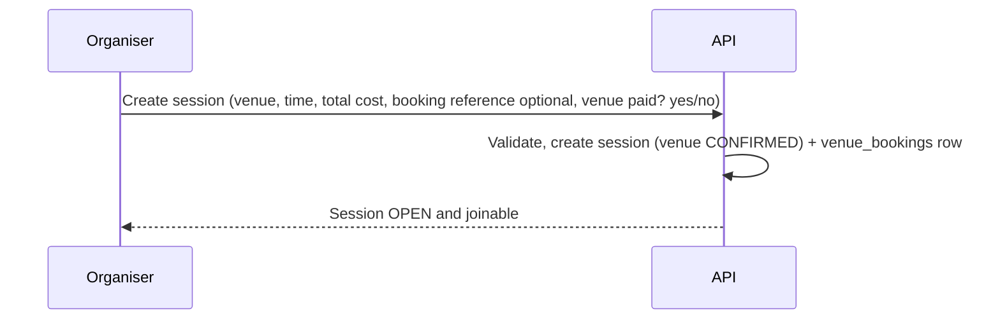
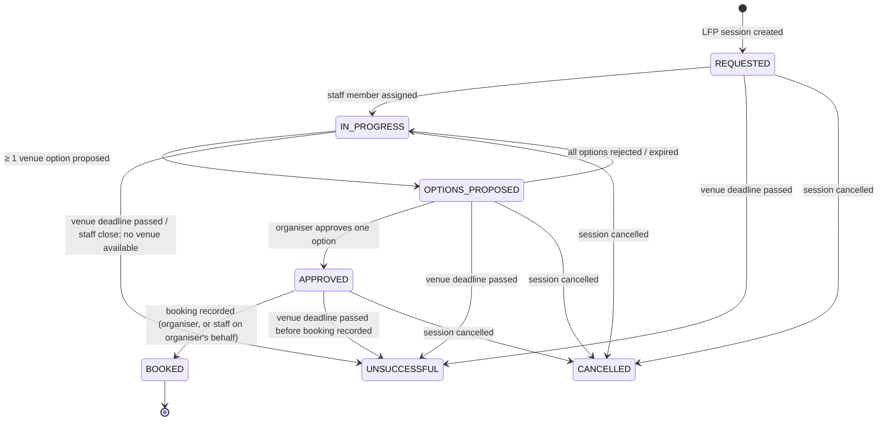

# Venue Management Workflow

PlayAround coordinates venue discovery and booking arrangements. The organiser approves the venue and pays it directly. PlayAround records the booking and never handles venue payments (DEC-014, DEC-029).

## 1. Venue catalogue

| Source | How a venue enters | Verified |
| --- | --- | --- |
| Staff (Operations) | Created in admin with full details | Can mark verified |
| Organiser | Picked from Google Places while creating a session; deduplicated by `google_place_id` | No, until staff verify |

Venue data: name, address, area, city, coordinates, timezone (Asia/Dubai), sports offered, images (Cloudinary), plus **staff-only** coordination fields: contact phone/email, booking channel and notes. Staff can merge duplicates; sessions are repointed and the merged venue keeps a `merged_into_id` pointer.

## 2. `EXISTING_BOOKING`

- `venue_bookings` stores the venue, time, total cost, optional reference (DEC-030), `recorded_by_id` = organiser, and `venue_payment_status` (`NOT_PAID` / `PAID`), which the organiser updates whenever they want. It's **informational only** and doesn't affect joinability.
- Changing venue or time later updates the booking record, writes a `session_events` entry and notifies participants.

## 3. `LOOKING_FOR_PLAYERS`

### Arrangement lifecycle

`BOOKED` sets the session's venue confirmation to `CONFIRMED`. The session becomes joinable (DEC-028). `UNSUCCESSFUL` at the deadline sets venue confirmation `LAPSED` and cancels the session (`VENUE_NOT_CONFIRMED`).

### Steps

1. **Request.** The organiser creates the session with a preferred area, preferred time, capacity, optional minimum and estimated cost. A `venue_arrangements` row (`REQUESTED`) appears in the admin **venue arrangement queue**.
2. **Coordinate.** An Operations staff member takes the request (`IN_PROGRESS`), checks catalogue venues near the area for the sport, and contacts venues outside the app (phone, WhatsApp, booking sites). Progress notes are logged on the arrangement and are staff-only.
3. **Propose.** Staff add one or more **venue options**: venue, start/end, total price, notes, optional `valid_until` (venues often hold slots only briefly). Organiser-proposed options are pending O-06. The organiser is notified (`VENUE_OPTIONS_PROPOSED`).
4. **Approve.** The organiser approves one option. Other open options become `WITHDRAWN`. Or the organiser rejects all, and coordination continues.
5. **Book and pay.** The organiser books (if staff haven't already reserved it) and **pays the venue directly**.
6. **Record.** The organiser, or staff on their behalf (audited), records the booking: reference (optional), final total cost and venue payment status. Session time and price are taken from the approved option, or from the recorded booking if it differs. The session moves to venue `CONFIRMED`, coordinates switch to the exact venue, and interested users are notified (`SESSION_JOINABLE`).

### Rules
- The venue confirmation deadline is pending O-02 (placeholder: 12 h before start, or 2 h before start for sessions created within 12 h).
- The option time must respect the deadline and keep `starts_at` in the future. It may differ from the organiser's preferred time; the organiser decides by approving.
- The estimated cost is not binding. Nobody has joined before confirmation, so no price consent is needed at this stage. Later price changes follow the price-change rules in the [session lifecycle](session-lifecycle.md#6-money-split-and-price-changes).
- Target response time for the staff queue is **not defined** (open item O-16 in the decision log).
- PlayAround never pays a venue, never takes a deposit, and never stores card details.

## 4. Admin queue

| Column | Notes |
| --- | --- |
| Session, sport, preferred area, preferred time, capacity, estimate | From the session |
| Status, assignee, time until venue deadline | Sorted by deadline |
| Options (count / state) | Links to the option editor |
| Activity log | Staff notes, organiser decisions, status changes |

Staff actions are role-checked (`OPERATIONS`, `SUPER_ADMIN`) and audited. See [roles and permissions](../product/roles-and-permissions.md).

## 5. Data

| Table | Purpose |
| --- | --- |
| `venues`, `venue_sports`, `venue_images` | Catalogue |
| `venue_arrangements` | One per LFP session: status, assignee, notes |
| `venue_options` | Proposed options: venue, time, price, status, proposer |
| `venue_bookings` | One per confirmed session (both types): venue, time, cost, reference, venue payment status, recorded by |

Full definitions are in [database/schema.md](../database/schema.md).
